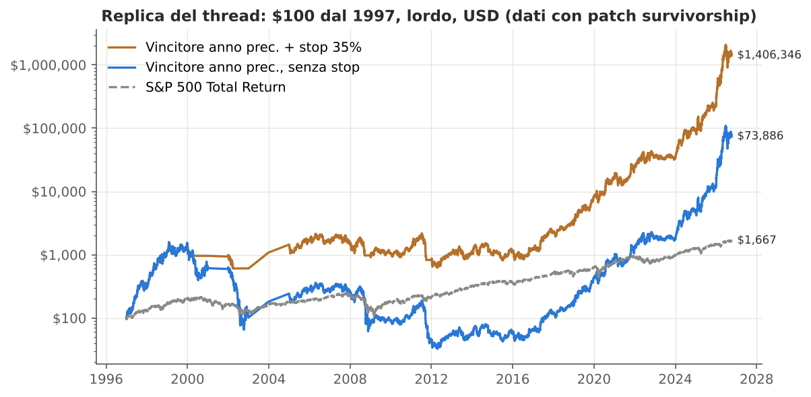
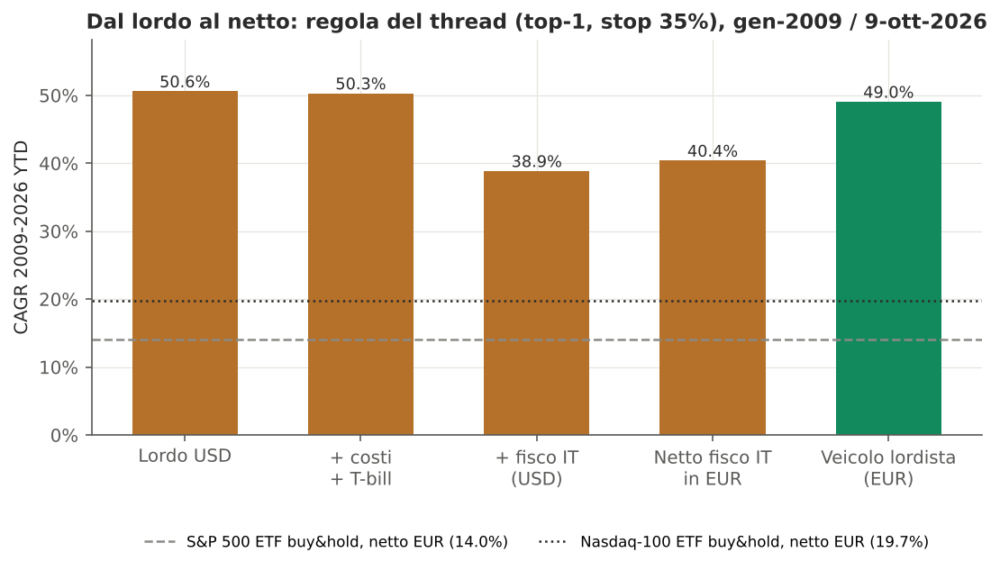
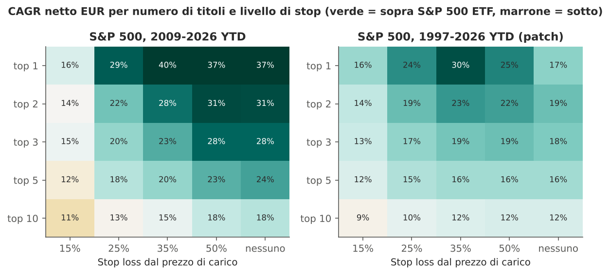
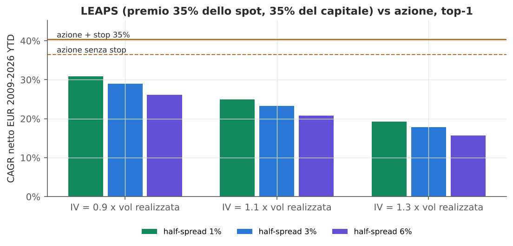
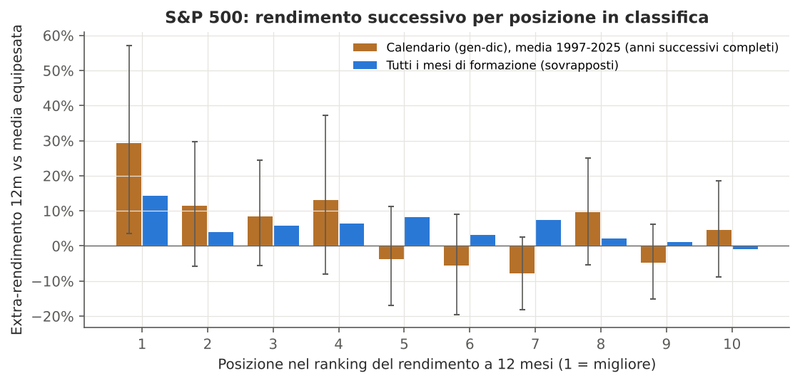
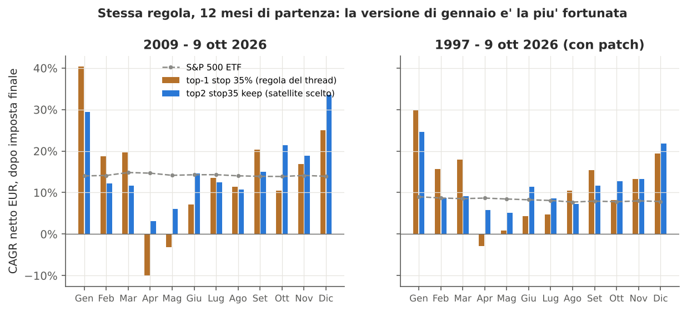
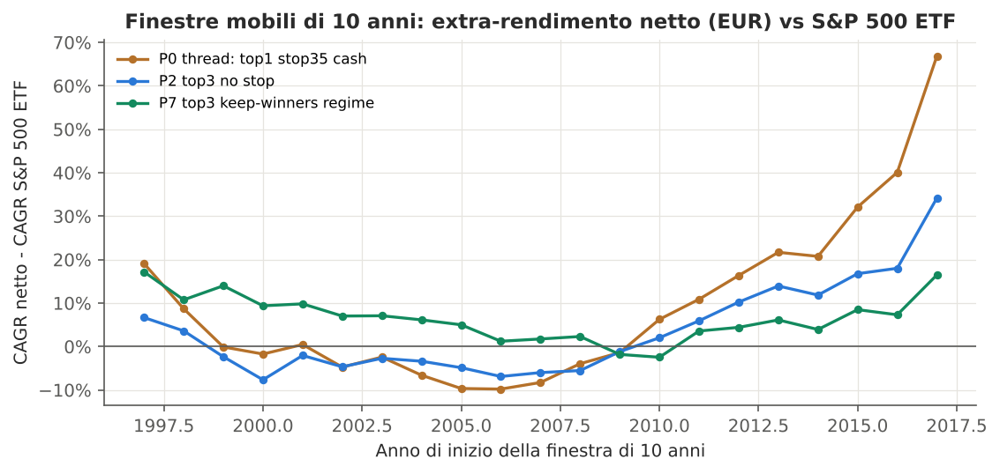
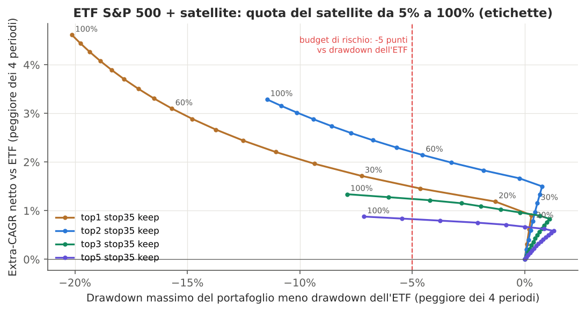
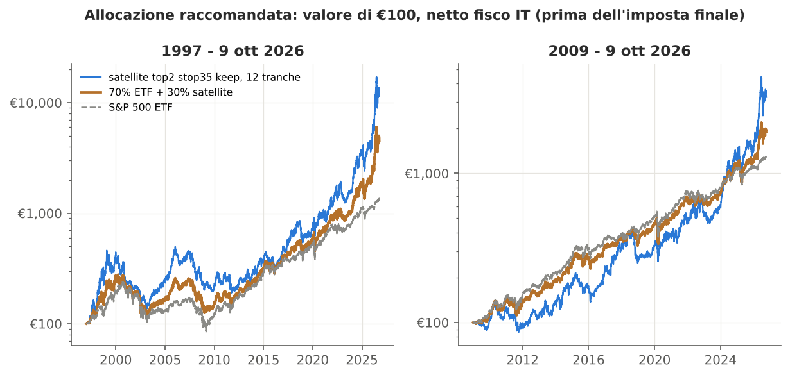

GRMS PARTNERS
Consulenza Patrimoniale Indipendente — Alta Sartoria Patrimoniale
Collana: Architettura Quantitativa
Area di competenza: Investment Advisory / Private Wealth / Tax Optimization

---

# Comprare il vincitore dell'anno precedente: evidenza empirica 1997-2026, impatto della fiscalità italiana e regola operativa per un family office

## Analisi quantitativa della strategia "January Buy" su S&P 500 e Nasdaq-100, con correzione dei titoli spariti, delle varianti proposte (top-N, stop-loss, LEAPS, orizzonti brevi) e dell'allocazione core-satellite raccomandata

*Documento riservato predisposto per il Consiglio di un family office. Dati di mercato aggiornati al 9 ottobre 2026; verifiche normative effettuate il 12 ottobre 2026.*

---

## Abstract

Il paper verifica la tesi, diffusa sui social network, secondo cui acquistare ogni gennaio l'azione dell'S&P 500 con il miglior rendimento dell'anno precedente avrebbe trasformato 100 dollari del 1997 in 1,5 milioni di dollari con uno stop-loss del 35%. L'analisi usa la composizione storica dell'indice (point-in-time) dal 1996, prezzi giornalieri con dividendi, il reinserimento di nove vincitori annuali assenti dai dati gratuiti ricostruiti dai documenti depositati alla SEC, un motore di backtest che applica la fiscalità della persona fisica residente in Italia in regime amministrato (26% sulle plusvalenze, zainetto quadriennale, 37,1% sui dividendi statunitensi, imposta di bollo, cambio EUR/USD storico) e 2.304 simulazioni per la selezione finale.

La replica conferma l'ordine di grandezza del thread: 100 dollari del 1997 diventano 1.406.346 dollari lordi con lo stop del 35%, contro 1.667 dollari dell'S&P 500. Il risultato tuttavia non regge come stima di ciò che un investitore otterrebbe. In primo luogo, la fiscalità italiana riduce la ricchezza finale dell'85%. In secondo luogo, gennaio è il più favorevole dei dodici mesi di partenza possibili: con partenza ad aprile la stessa regola perde denaro dal 2009 a oggi. In terzo luogo, la ricchezza è concentrata in pochi anni (2024 e 2026 su tutti). Le LEAPS al 35% del sottostante rendono meno delle azioni in ogni scenario di prezzo esaminato.

Ripartita su dodici partenze mensili, la regola conserva un vantaggio netto rispetto all'ETF S&P 500 in tutti e quattro i periodi esaminati, ma con drawdown molto più profondi. Secondo il criterio dichiarato nel paper, l'impiego difendibile è un satellite "top-2, stop 35%, mantenimento dei titoli riconfermati, 12 tranche mensili", con peso massimo del 60% e peso raccomandato del 30% accanto a un core in ETF S&P 500. Con ribilanciamento annuale, il vantaggio storico di questa allocazione è di circa 1,5-3,8 punti di rendimento annuo a seconda del periodo, con drawdown massimi inferiori a quelli dell'ETF.

---

## Executive summary

**La domanda.** Il Consiglio ha chiesto se la regola "compra a gennaio il titolo migliore dell'anno precedente, vendi a fine anno" sia applicabile al patrimonio della famiglia, in quale versione e con quale peso.

**Il thread è replicabile, ma non è una stima affidabile.** Con dati corretti per i titoli spariti, 100 dollari investiti nel 1997 diventano circa 1,4 milioni di dollari lordi con lo stop del 35% (il thread indica circa 1,5 milioni). Tre fattori separano però questo numero da ciò che la famiglia incasserebbe.

1. **Fisco italiano.** Sullo stesso periodo il valore finale lordo in euro passa da 1,57 milioni a 237 mila euro dopo le imposte. La regola realizza plusvalenze ogni anno; un ETF tenuto in portafoglio, invece, le rinvia alla vendita.
2. **Fortuna del calendario.** La stessa regola avviata in un mese diverso da gennaio ottiene risultati molto inferiori. Dal 2009 a oggi, al netto delle imposte, il rendimento annuo è del 40,4% con partenza a gennaio e del -10,1% con partenza ad aprile.
3. **Concentrazione nel tempo.** Togliendo il solo 2026 (Sandisk, +566% da inizio anno) resta il 15% della ricchezza finale. Togliendo i cinque anni migliori resta lo 0,5%.

**Che cosa resta.** Per eliminare la fortuna del calendario la regola è stata ripartita in 12 tranche mensili, ciascuna ribilanciata una volta l'anno in un mese diverso. In questa forma tutte le versioni con stop al 35% e senza filtro di mercato battono l'ETF S&P 500 in tutti e quattro i periodi esaminati:

- 2009-2026;
- 1997-2026;
- gli stessi due periodi chiusi a fine 2025, cioè senza l'anno anomalo in corso.

Il costo è un drawdown molto più profondo: fino al -73% contro il -65% dell'ETF nel periodo lungo, e il -54% contro il -34% dal 2009.

**Che cosa non funziona.**

- Stop stretti (15-25%).
- Orizzonti brevi: classifica a 6 mesi o ribilanciamento mensile.
- LEAPS al 35% del sottostante: rendono meno delle azioni e, con il 100% del capitale in premi, azzerano il capitale.
- Filtro di mercato sulla media mobile a 10 mesi: riduce le perdite del 2000-2002 ma costa troppo dopo il 2009.

**Raccomandazione.** Core in ETF UCITS S&P 500 ad accumulazione, più un satellite "January Buy" in versione top-2 con stop al 35% dal prezzo di carico, mantenimento dei titoli riconfermati e 12 tranche mensili.

- **Peso massimo del satellite: 60%.** È la quota che massimizza il vantaggio nel periodo peggiore senza superare di oltre 5 punti il drawdown dell'ETF.
- **Peso raccomandato: 30%,** cioè metà del massimo, perché il vantaggio storico non è statisticamente certo. La probabilità che lo Sharpe vero del satellite superi quello dell'ETF è stimata al 74%.
- **Ribilanciamento annuale** con banda di 5 punti.

| Indicatore (netto fisco IT, EUR) | ETF S&P 500 | 70% ETF / 30% satellite (ribilanciato) |
|---|---|---|
| CAGR 2009 - 9 ott 2026 | 13,8% | 16,6% |
| CAGR 1997 - 9 ott 2026 | 8,2% | 12,0% |
| CAGR 2009 - 2025 (senza 2026) | 13,3% | 14,9% |
| CAGR 1997 - 2025 (senza 2026) | 7,7% | 10,4% |
| Max drawdown 2009-2026 | -33,6% | -30,8% |
| Max drawdown 1997-2026 | -65,4% | -58,0% |

**Le condizioni da accettare.**

- Dal 2009 al 2023 l'allocazione mista ha reso quanto l'ETF, o leggermente meno: il vantaggio si concentra nel 1998-2008 e nel 2024-2026.
- Il satellite può concentrarsi su un solo titolo. Al 9 ottobre 2026 Sandisk compare in 11 delle 12 tranche e pesa circa metà del satellite.
- Lo stop non protegge dai gap di apertura.

Il Consiglio dovrebbe adottare il satellite solo se è disposto a tollerare dieci o più anni di risultati allineati al mercato in cambio di un vantaggio atteso che, storicamente, si è manifestato a ondate.

---

## Indice

1. Introduzione e domande di ricerca
2. Inquadramento teorico e rassegna della letteratura
3. Dati, fonti e metodologia
   - 3.1 Universo point-in-time e copertura dei prezzi
   - 3.2 I titoli spariti: vincitori reinseriti e società non più quotate
   - 3.3 Regole del backtest
   - 3.4 Modello fiscale (persona fisica residente, regime amministrato)
   - 3.5 Benchmark, campioni e test statistici
   - 3.6 Protocollo di selezione e sua revisione dichiarata
4. Analisi quantitativa
   - 4.1 Le prime tre azioni di ogni anno
   - 4.2 Replica del thread
   - 4.3 Dal lordo al netto: costi, fisco, cambio
   - 4.4 Varianti richieste: numero di titoli, stop, dopo lo stop, orizzonti
   - 4.5 La versione LEAPS
   - 4.6 Robustezza: rank, placebo, calendario, finestre, fattori
   - 4.7 Selezione finale e allocazione core-satellite
5. Scenari prospettici e stress test
6. Casi di studio
7. Implicazioni pratiche e regola operativa
8. Rischi, limiti dell'analisi e contro-argomentazioni
9. Conclusioni e key takeaways
- Appendice A — Revisione critica (Fase 3): dieci debolezze e correzioni
- Appendice B — Checklist di verifica prima della consegna
- Appendice C — Riproducibilità e file consegnati

---

## 1. Introduzione e domande di ricerca

Nel corso del 2026 ha circolato su X un thread secondo cui la regola più semplice immaginabile, comprare ogni gennaio l'azione migliore dell'anno precedente e rivenderla a fine anno, avrebbe battuto l'S&P 500 di diversi ordini di grandezza. Le cifre citate sono tre. Primo: 100 dollari investiti nel 2012 sarebbero diventati 176.114 dollari, contro 800 dollari dell'indice. Secondo: su trent'anni dal 1997 sarebbero diventati 89.418 dollari, contro 1.752. Questa seconda serie avrebbe però perso il 97% tra il 1999 e il 2011 e impiegato 23 anni per tornare in pari. Terzo: con uno stop-loss del 35% dal prezzo di carico il risultato trentennale sarebbe salito a 1.514.581 dollari.

Per un family office la domanda non è se il thread sia "vero" in senso aritmetico, ma se la regola, o una sua variante, sia un impiego difendibile del capitale. Per esserlo deve reggere a tre condizioni:

- deve essere replicabile con dati che includano anche le società poi scomparse dal listino;
- deve sopravvivere alla fiscalità effettivamente applicabile alla famiglia;
- non deve dipendere da scelte arbitrarie, come il mese di partenza, o da pochi episodi irripetibili.

Il paper risponde a quattro domande di ricerca:

- **DR1.** I numeri del thread sono replicabili con un universo point-in-time che includa i titoli spariti? Le società vincitrici sono mai fallite nell'anno di detenzione?
- **DR2.** Quanto del risultato sopravvive a costi di transazione, cambio EUR/USD e fiscalità italiana (26%, zainetto quadriennale, dividendi esteri, imposta di bollo)? Quanto vale un veicolo a imposizione differita?
- **DR3.** Quali varianti sono robuste? Si considerano numero di titoli, livello e tipo di stop, comportamento dopo lo stop, orizzonti più brevi, LEAPS con premio pari al 35% del sottostante e filtro di regime. Per robuste si intendono varianti che non siano il frutto di una ricerca a posteriori tra molte prove.
- **DR4.** Se la regola va adottata, in quale forma operativa e con quale peso nel patrimonio azionario di un family office?

Il paper adotta una presentazione neutra. Le stesse misure sono riportate per la strategia e per i benchmark: ETF S&P 500 e Nasdaq-100, in acquisto e mantenimento e in rotazione annuale. Si distinguono sempre:

- i **fatti**, cioè dati verificati con fonte;
- le **stime**, cioè calcoli dell'autore con ipotesi dichiarate;
- le **opinioni professionali**, cioè giudizi che dipendono dagli obiettivi della famiglia.


---

## 2. Inquadramento teorico e rassegna della letteratura

### 2.1 Momentum: l'evidenza accademica di riferimento

La regola del thread è una forma estrema di momentum azionario: compra pochi titoli che hanno fatto meglio degli altri negli ultimi dodici mesi.

**Evidenza di riferimento.** Jegadeesh e Titman (Journal of Finance, 1993) documentano che i titoli vincitori degli ultimi 3-12 mesi tendono a fare meglio dei perdenti nei 3-12 mesi successivi. Carhart (Journal of Finance, 1997) introduce il fattore momentum (UMD) nei modelli di valutazione della performance. Asness, Moskowitz e Pedersen (Journal of Finance, 2013) mostrano che il fenomeno è presente in molte classi di attività e mercati.

**Differenza dal thread.** In tutta questa letteratura il momentum si misura su portafogli ampi, decili o terzili dell'universo con centinaia di titoli. La regola in esame ne compra uno solo, o pochi: la statistica che la sostiene è la coda destra della distribuzione, non la media di un decile.

**Spiegazioni proposte per la persistenza.**

- **Sottoreazione:** gli investitori incorporano le notizie con ritardo.
- **Effetto disposizione:** gli investitori vendono troppo presto i titoli in guadagno, frenando l'aggiustamento del prezzo. Grinblatt e Han (Journal of Financial Economics, 2005) ne danno una formalizzazione.
- **Ancoraggio ai massimi:** George e Hwang (Journal of Finance, 2004) mostrano che la vicinanza al massimo a 52 settimane spiega buona parte del momentum.

Il paper non prende posizione su quale spiegazione prevalga. Interessa solo se il fenomeno sia sfruttabile al netto dei costi effettivi.

### 2.2 Le forze contrarie

**Rischio di reversal.** Al momentum si oppongono due evidenze altrettanto consolidate:

- De Bondt e Thaler (Journal of Finance, 1985) documentano l'inversione dei rendimenti su orizzonti di 3-5 anni.
- Bali, Cakici e Whitelaw (Journal of Financial Economics, 99(2), 2011, pp. 427-446) documentano l'effetto "lotteria": i titoli con rendimenti giornalieri estremi nel mese precedente tendono a sottoperformare in seguito.

Il vincitore assoluto di un anno è per costruzione un titolo con rendimenti estremi, quindi esposto a entrambe le forze.

**Rischio di crollo.** Daniel e Moskowitz ("Momentum Crashes", Journal of Financial Economics, 2016) mostrano che le strategie momentum subiscono perdite concentrate e improvvise nelle fasi di rimbalzo dopo i mercati ribassisti. Barroso e Santa-Clara (Journal of Financial Economics, 116(1), 2015, pp. 111-120) mostrano che scalare l'esposizione per la volatilità recente ne riduce la gravità. Entrambi i temi sono stati testati: stop-loss, filtro di regime e controllo di volatilità.

### 2.3 Filtri di regime

Faber ("A Quantitative Approach to Tactical Asset Allocation", Journal of Wealth Management, 2007) ha reso popolare una regola semplice: si detengono attività rischiose solo quando l'indice è sopra la media mobile a 10 mesi. La regola è qui usata come variante. Non è un filtro "ottimizzato": è la specifica più diffusa in letteratura, adottata così com'è per evitare di adattarla ai dati.

### 2.4 Rischio di sovra-adattamento e fortuna del calendario

Tre fonti di distorsione rendono inaffidabili i backtest con molte varianti.

**Selezione tra molte prove.** Harvey, Liu e Zhu (Review of Financial Studies, 29(1), 2016) mostrano che, con centinaia di fattori testati, le soglie convenzionali di significatività vanno alzate. Bailey e López de Prado (Journal of Portfolio Management, 2014) propongono il Deflated Sharpe Ratio: misura la probabilità che lo Sharpe migliore tra N prove sia superiore a zero, tenuto conto del numero di prove, dell'asimmetria e della curtosi dei rendimenti.

**Fortuna del ribilanciamento.** Una strategia ribilanciata una volta l'anno in una data fissa è solo una delle dodici implementazioni possibili. La letteratura professionale sul cosiddetto "rebalance timing luck" (ricerche pubblicate da Newfound Research) [DA VERIFICARE: estremi bibliografici puntuali] mostra che la scelta della data può spostare i risultati in misura comparabile al premio che si vuole misurare. Il paper tratta questo punto come centrale: la regola del thread usa gennaio per convenzione, non per una ragione economica.

**Survivorship bias.** Brown, Goetzmann, Ibbotson e Ross (Review of Financial Studies, 1992) documentano la distorsione che nasce dall'escludere dai dati le entità poi scomparse. Per una regola che seleziona il titolo migliore il rischio è specifico: se il vincitore di un anno è stato acquisito o è uscito dal listino, nei dati gratuiti spesso non c'è. La classifica, allora, incorona il secondo o il terzo.

### 2.5 Approcci a confronto

| Approccio | Pro | Contro | Rilevanza per il family office |
|---|---|---|---|
| Momentum di decile, fattore UMD | Ampia diversificazione; evidenza accademica solida | Rotazione elevata, quindi imposte realizzate ogni anno; extra-rendimento netto modesto per un investitore retail tassato | Implementabile con ETF fattoriali; non oggetto di questo studio |
| Vincitore singolo (regola del thread) | Semplicità estrema; coda destra molto ricca | Rischio idiosincratico massimo; dipendenza dal calendario; reversal e lotteria | Solo come satellite, con regole di rischio |
| Top-N con stop e tranche (soluzione proposta) | Diversifica nel tempo e, parzialmente, tra titoli; perdita per titolo limitata | Concentrazione residua quando un titolo domina; gap di apertura | Candidato satellite (sezione 4.7) |
| ETF S&P 500 in acquisto e mantenimento | Costo minimo; imposta rinviata alla vendita | Nessun extra-rendimento; drawdown di mercato pieni | Core di riferimento |

---

## 3. Dati, fonti e metodologia

### 3.1 Universo point-in-time e copertura dei prezzi

**Composizione dell'indice.** Per l'S&P 500 si usano gli intervalli di appartenenza storici dal 1996 della raccolta pubblica fja05680/sp500, distribuita con i prezzi nel progetto Johnbrick123/sp500-data. Per il Nasdaq-100 si usano gli intervalli dal 2007 del progetto jmccarrell/n100tickers. Per gli anni precedenti, 1990-1995 per l'S&P 500 e 1990-2006 per il Nasdaq-100, non esiste una composizione storica gratuita. Le classifiche di quegli anni sono costruite sui membri di una data successiva e sono marcate come proxy (qualità "P"): sono indicative e non entrano in alcun backtest.

**Prezzi.**

- Prezzi giornalieri rettificati per dividendi e operazioni sul capitale dal progetto Johnbrick123/sp500-data, che aggrega Yahoo Finance, Tiingo, Quandl WIKI e Kaggle.
- Yahoo Finance, scaricato via browser nell'ottobre 2026, per il Nasdaq-100 e per gli indici di riferimento (S&P 500 Total Return, ETF SPY e QQQ).
- FRED (Federal Reserve Bank of St. Louis) per tassi T-bill e cambio EUR/USD.
- Kenneth French Data Library per i fattori di rischio.

Ultima seduta disponibile: venerdì 9 ottobre 2026.

**Copertura.** Non tutti i membri storici dell'indice hanno prezzi nei dati gratuiti. Le società uscite dal listino prima del 2005 sono le più colpite. La quota di membri dell'S&P 500 classificabili a fine anno è:

| Anno | 1996 | 2000 | 2005 | 2010 | 2018 | 2026 |
|---|---|---|---|---|---|---|
| Membri classificabili / membri dell'indice | 245/499 | 321/503 | 377/501 | 477/500 | 505/505 | 500/503 |
| Copertura (%) | 49% | 64% | 75% | 95% | 100% | 99% |

In tutto, 336 ticker che sono stati membri dell'S&P 500 tra il 1996 e il 2026 non hanno alcun prezzo nei dati gratuiti. L'elenco anno per anno è nel foglio "Spariti_membri_senza_dati" dell'Excel dei risultati. Dove il registro delle variazioni dell'indice di Wikipedia ("Historical components of the S&P 500", scaricato il 12 ottobre 2026) lo consente, l'elenco riporta nome della società, data e motivo dell'uscita. Il registro è però scarno prima del 2007: il nome è disponibile per 70 dei 336 ticker.

**Controlli di qualità.** I dati sono stati sottoposti a quattro controlli.

1. **Salti spuri.** Sono stati riparati automaticamente i giorni in cui il rendimento rettificato e quello del prezzo divergevano di oltre 15 punti senza un dividendo che lo giustificasse. I casi tipici sono frazionamenti registrati due volte: per esempio U.S. Bancorp 1997, XTO, Green Mountain, Pepsi Bottling, AMCC. Il registro completo è nel foglio "Riparazioni_dati".
2. **Serie errata.** Una serie è stata esclusa perché conteneva i prezzi di un'altra società: il ticker SNT, delistato nel 1999.
3. **Dati 2026.** Le serie che nel 2026 mostravano movimenti eccezionali sono state verificate su fonti di stampa indipendenti: Moderna +177% il 19 agosto 2026, Dell oltre +30% il 29 maggio 2026 dopo i risultati trimestrali, Sandisk sopra 1.500 dollari, Micron intorno a 1.000 dollari.
4. **Delisting nel 2026.** Le società uscite dal listino nel 2026 sono state verificate sul registro delle variazioni dell'indice: Coterra, acquisita da Devon Energy a maggio, ed Electronic Arts, acquisita da un consorzio ad agosto.

### 3.2 I titoli spariti: vincitori reinseriti e società non più quotate

Il cliente ha chiesto due cose precise: quali sono i titoli spariti, e se la regola avrebbe mai comprato una società fallita nell'anno di detenzione.

**I vincitori reinseriti.** Il rischio per questa regola non è la società che fallisce mentre la si detiene. È la società che vince l'anno e manca dai dati, così che la classifica incorona un altro titolo. Per ogni anno dal 1996 al 2008, quando la copertura è inferiore al 95%, la top-3 è stata confrontata con fonti indipendenti:

- l'elenco S&P Dow Jones Indices dei 50 migliori rendimenti annui di un titolo dell'S&P 500 dal 1980 al 2022;
- le rassegne di fine anno di CNN/Money, Forbes e Plansponsor;
- le tabelle di rendimento totale per l'azionista (dati S&P/Research Data Group, dividendi reinvestiti) che ogni società pubblica nel proxy statement (Form DEF 14A);
- le tabelle dei prezzi minimi e massimi trimestrali nel 10-K, su SEC EDGAR.

Nove vincitori erano membri dell'indice a fine anno ma senza prezzi nei dati gratuiti. Sono stati reinseriti come serie ricostruite che riproducono il rendimento dell'anno di classifica, il rendimento dell'anno di detenzione e l'eventuale intervento dello stop al 35%, ricavato dai minimi trimestrali del 10-K.

| Anno classifica | Società | Rend. anno (%) | Anno detenzione (%) | Stop 35% | Fonti |
|---|---|---|---|---|---|
| 1999 | Sprint PCS Group | +343,2% | -60,1% | si, il 2000-09-15 | Sprint DEF 14A 2001 (tabella TSR); Sprint 10-K 2000 (min/max trimestrali) |
| 1999 | Nextel Communications | +336,5% | -52,0% | si, il 2000-11-10 | Nextel DEF 14A 2002 (TSR); Nextel 10-K 2000 |
| 2000 | Reebok International | +234,0% | -3,1% | no | S&P DJI, 50 migliori rendimenti a 1 anno 1980-2022 (prezzo); Reebok 10-K 2001/2002 |
| 2000 | Dynegy | +220,2% | -54,2% | si, il 2001-09-17 | Dynegy DEF 14A 2002 e 2005 (TSR S&P IMS); Dynegy 10-K 2001 |
| 2002 | Providian Financial | +82,8% | +79,4% | no | Providian DEF 14A 2004/2005 (TSR); 10-K 2003 |
| 2003 | Avaya | +428,0% | +33,0% | no | Forbes 5-1-2004; S&P DJI; Avaya 10-K FY2004-05 |
| 2003 | Dynegy | +262,6% | +7,9% | no | Dynegy DEF 14A 2005 (TSR); 10-K 2004 |
| 2004 | TXU Corp. | +178,0% | +59,9% | no | TXU DEF 14A 2006 (TSR); 10-K 2005; CNN/Money |
| 2008 | UST Inc. | +26,6% | +0,0% | no | CNN/Money 31-12-2008; 8-K Altria gen-2009 |

*Le serie ricostruite sono esatte solo per la regola annuale di gennaio. Per gli altri mesi di partenza sono interpolazioni log-lineari dei valori annui (limite dichiarato, sezione 8).*

**Una riconciliazione.** Per Dynegy 2000 l'elenco S&P DJI riporta +361%, mentre la tabella della società riporta +220,2%. Il 10-K, rettificato per il rapporto di cambio 0,69 della fusione con Illinova del febbraio 2000, indica un minimo del primo trimestre di 17,30 dollari: è coerente con +220% e non con +361%, che corrisponde al titolo non rettificato. Si usa quindi +220,2%. Ne segue che il vero vincitore del 2000 sul rendimento totale è Reebok (+234%), non Dynegy.

**Valori da verificare.** Due valori restano da verificare: il rendimento 2001 di Reebok (intervallo tra -8,6% e -1,4%; usato -3,1%) e quello 2004 di Avaya (circa +33%). In entrambi i casi lo stop non è toccato e l'effetto sulla regola è limitato. [DA VERIFICARE: rendimento totale esatto Reebok 2001 e Avaya 2004.]

**Membri ancora mancanti.** Restano assenti tre membri noti con rendimenti elevati: LSI Logic 1999 (+319%), Nortel Networks 1999 (+304%; non presente nel file di appartenenza point-in-time) e Novell 2003 (+215%). Si collocano tutti sotto la terza posizione e non modificano la top-3.

**Le società non più quotate e il punto del cliente.** Dei 78 titoli distinti (per ticker) che compaiono nella top-3 dell'S&P 500 tra il 1996 e il 2026, 25 non sono più quotati oggi. Corrispondono a 24 società, perché Dynegy compare due volte, e comprendono le nove serie ricostruite. Nel Nasdaq-100 dal 2007 i titoli non più quotati sono 4 su 45. L'elenco completo, con l'esito societario, è nella tabella della sezione 4.1 e nel foglio "Spariti_top3".

L'affermazione del cliente è confermata dai dati: nessuna società della top-3 di un anno è andata a zero nell'anno successivo, quello in cui la regola la detiene.

- **Unico caso uscito entro l'anno successivo:** UST Inc., acquisita in contanti da Altria il 6 gennaio 2009 a 69,50 dollari per azione, cioè a premio e senza perdita.
- **Peggiori risultati nell'anno di detenzione:**
  - Nvidia 2002: -82,8%;
  - National Oilwell Varco 2008: -66,7%;
  - Netflix 2011: -60,6%;
  - Sprint PCS 2000: -60,1%;
  - Dynegy 2001: -54,2%;
  - Qualcomm 2000: -53,3%.
- **Fallimenti più lontani:** Dynegy (procedura di Chapter 11 tra il 2011 e il 2012) e J.C. Penney (Chapter 11 nel 2020) sono fallite un decennio o più dopo l'anno in cui erano state tra i vincitori.

### 3.3 Regole del backtest

- **Classifica:** all'ultima seduta dell'anno solare, rendimento totale dell'anno (dividendi reinvestiti) di tutti i membri dell'indice in quella data. Una società quotata da meno di un anno, per esempio uno spin-off come Sandisk nel 2025, compete con il rendimento dalla prima quotazione se ha almeno 126 sedute di storia. L'alternativa di escluderla è testata (sezione 4.4).
- **Esecuzione:** vendita alla chiusura dell'ultima seduta dell'anno; acquisto all'apertura della prima seduta del nuovo anno. Se un titolo selezionato non è acquistabile, per esempio perché i dati terminano il giorno della classifica per un'acquisizione, si prende il successivo.
- **Stop-loss:** il livello è fissato al -35% dal prezzo di carico e verificato sul minimo intraday. Se il livello è toccato, l'esecuzione avviene al livello stesso, oppure all'apertura se il titolo apre già sotto (gap). Dopo lo stop la quota resta in T-bill fino al ribilanciamento successivo. Sono testati anche lo stop sulla chiusura, lo stop "trailing" e la sostituzione con il nuovo leader.
- **Costi:** 10 punti base per lato su ogni compravendita.
- **Liquidità:** rende il tasso T-bill a 3 mesi, al netto dell'imposta del 12,5% sui titoli di Stato.
- **Valuta:** risultati in dollari, come nel thread, e in euro per l'investitore italiano. Per gli anni anteriori al 1999 si usa un euro sintetico ricavato dal marco tedesco (1,95583 marchi per euro).
- **Valore finale "dopo liquidazione":** il valore del dossier se tutto venisse venduto all'ultima data, al netto delle imposte dovute. Rende confrontabili strategie che pagano le imposte ogni anno e un ETF che le rinvia.

### 3.4 Modello fiscale (persona fisica residente, regime amministrato)

Le regole fiscali sono state verificate su fonti aggiornate al 2026. Per l'elenco delle fonti e la data di verifica si veda l'Appendice B.

| Voce | Trattamento applicato | Riferimento |
|---|---|---|
| Plusvalenze su azioni e opzioni | Redditi diversi, imposta sostitutiva del 26% a ogni realizzo | Art. 67 TUIR; aliquota 26% |
| Minusvalenze | Zainetto: compensabili con redditi diversi nell'anno e nei quattro periodi d'imposta successivi; si usano per prime le più vecchie | Art. 68, comma 5, TUIR |
| ETF armonizzati | Proventi = redditi di capitale (26%), non compensabili con lo zainetto; le minusvalenze su ETF sono redditi diversi | Prassi corrente; riforma prevista dalla L. 111/2023 non attuata alla data |
| Dividendi USA | Ritenuta USA 15% (convenzione, con modulo W-8BEN) e 26% sul netto: carico effettivo 37,1% | Fonte secondaria, settembre 2026 |
| Interessi su T-bill | 12,5% (titoli di Stato di Paesi in white list) | Fonte secondaria |
| Imposta di bollo | 0,20% annuo sul valore del dossier al 31 dicembre | D.P.R. 642/1972, Tariffa, art. 13 [DA VERIFICARE: comma] |
| Cambio | Plusvalenze calcolate in euro ai cambi delle date di acquisto e di vendita | [DA VERIFICARE: riferimento normativo puntuale] |
| Costo fiscale di titoli uguali | Nel regime amministrato l'intermediario applica il costo medio ponderato | Fonte secondaria [DA VERIFICARE: norma] |

Il motore applica la regola dello zainetto e l'asimmetria degli ETF. Le minusvalenze che scadono inutilizzate sono registrate separatamente. Un ETF venduto in perdita genera uno zainetto che non può compensare i proventi di un altro ETF: è il motivo per cui la rotazione annuale di ETF è particolarmente inefficiente in Italia (sezione 4.3).

**Veicolo a imposizione differita.** Si simula anche un veicolo che rinvia l'imposta al 26% sul guadagno complessivo fino al disinvestimento. Il riferimento in prassi sono le polizze vita di ramo III (unit-linked): imposta al riscatto, switch tra fondi interni fiscalmente neutri, imposta di bollo 0,20% annua (fonte secondaria, settembre 2026). Il risultato è un limite superiore teorico: non include i costi del contratto e presuppone che il veicolo consenta di replicare la regola. Entrambi i punti vanno verificati caso per caso [DA VERIFICARE: fattibilità di un fondo interno dedicato e costi].

### 3.5 Benchmark, campioni e test statistici

**Benchmark.** ETF UCITS ad accumulazione su S&P 500 (TER 0,07%) e su Nasdaq-100 (TER 0,30%). Si ipotizza una ritenuta del 15% sui dividendi a livello di fondo, ricavata dal rendimento da dividendi di SPY e QQQ. I regimi simulati sono tre:

- acquisto e mantenimento, con imposta alla vendita finale;
- vendita e riacquisto ogni anno, con l'asimmetria fiscale degli ETF;
- un regime ipotetico simmetrico, per isolare l'effetto dell'asimmetria.

**Campioni.**

| Campione | Periodo | Caratteristica |
|---|---|---|
| Principale | gennaio 2009 - 9 ottobre 2026 | Copertura dei prezzi superiore al 93% |
| Lungo | gennaio 1997 - 9 ottobre 2026 | Include i nove vincitori reinseriti |

Entrambi sono riportati anche con chiusura al 31 dicembre 2025: il 2026 in corso è un anno estremo per la regola, con Sandisk a +566% da inizio anno.

**Test statistici.**

- Test per posizione in classifica (1°, 2°, ..., 10°): rendimento dell'anno successivo rispetto alla media equipesata dell'universo, con intervalli di confidenza bootstrap.
- Lo stesso test con formazione a ogni fine mese su finestre sovrapposte, con errori standard di Newey-West (Econometrica, 1987).
- Placebo con scelta casuale tra le posizioni 2-10, tra tutti i membri, tra le prime tre.
- Ricampionamento dei rendimenti annui (con reimmissione, non stazionario).
- Rimozione degli anni migliori.
- Finestre mobili di 10 anni.
- Regressioni sui fattori di Fama e French (Journal of Financial Economics, 1993) e di Carhart (1997), con errori robusti.
- Deflated Sharpe Ratio.
- Selezione walk-forward.

### 3.6 Protocollo di selezione e sua revisione dichiarata

**Protocollo iniziale.** Prima della selezione finale era stato fissato un protocollo:

- 48 configurazioni: numero di titoli 1, 2, 3, 5; stop nessuno, 35%, 50%; filtro di regime sì o no; mantenimento dei titoli riconfermati sì o no;
- ogni configurazione valutata su 12 tranche mensili e in quattro periodi (2.304 backtest);
- vince la configurazione con il miglior extra-rendimento sull'ETF nel periodo peggiore, con drawdown massimo non oltre il -50% nel campione principale e il -55% in quello lungo.

**Perché è stato rivisto.** Applicato ai risultati, il protocollo si è rivelato mal posto: l'ETF S&P 500 stesso ha un drawdown del -65% nel campione lungo (in euro, 2000-2009) e non rispetterebbe il vincolo. Un vincolo che il mercato non rispetta non distingue la strategia dal mercato. Inoltre nessun family office deterrebbe una regola su singoli titoli come unica componente azionaria.

**Il criterio rivisto,** dichiarato qui in modo esplicito come deviazione dal protocollo:

1. per ognuna delle 48 regole e per ogni quota di satellite dal 5% al 100%, con passo del 5%, si calcola il portafoglio "ETF S&P 500 + satellite", senza ribilanciamento tra le due parti;
2. sono ammesse solo le combinazioni il cui drawdown massimo non supera quello dell'ETF di oltre 5 punti percentuali in nessuno dei quattro periodi;
3. tra le ammesse, vince la coppia regola-quota con il miglior extra-rendimento nel periodo peggiore: la quota vincente è il tetto massimo;
4. la quota raccomandata è metà del tetto, arrotondata al 5% inferiore, per tenere conto dell'errore di stima del vantaggio storico.

**Lettura corretta.** Il risultato del protocollo originario era stato visto prima della revisione: il criterio rivisto non è quindi una verifica fuori campione. La sezione 4.7 riporta per trasparenza entrambe le letture e una selezione walk-forward, che usa solo i dati disponibili in ciascun anno.


---

## 4. Analisi quantitativa

### 4.1 Le prime tre azioni di ogni anno

La tabella riporta per l'S&P 500 le prime tre azioni di ogni anno solare dal 1996 per rendimento totale (dividendi inclusi), il rendimento dell'anno successivo del primo classificato e la copertura dei prezzi. Le serie ricostruite da documenti SEC sono indicate con un asterisco.

| Anno | 1° | 2° | 3° | Anno dopo, 1° (%) | Copertura prezzi, anno intero (%) |
|---|---|---|---|---|---|
| 1996 | Dell (1988-2013) (+207%) | TJX Companies (+154%) | Rowan Companies (+135%) | +216,2% | 48% |
| 1997 | Dell (1988-2013) (+216%) | Navistar International (+161%) | Cincinnati Financial (+121%) | +248,5% | 52% |
| 1998 | Dell (1988-2013) (+249%) | Apple Inc. (+212%) | EMC Corp. (+210%) | +39,4% | 55% |
| 1999 | Qualcomm (+2619%) | Sprint PCS Group* (+343%) | Nextel Communications* (+337%) | -53,3% | 60% |
| 2000 | Reebok International* (+234%) | Dynegy* (+220%) | EOG Resources (+213%) | -3,1% | 64% |
| 2001 | Nvidia (+308%) | Office Depot (ODP Corp.) (+160%) | J.C. Penney (+155%) | -82,8% | 66% |
| 2002 | Providian Financial* (+83%) | Boston Scientific (+76%) | Newmont (+53%) | +79,4% | 70% |
| 2003 | Avaya* (+428%) | Williams Companies (+266%) | Dynegy* (+263%) | +33,0% | 72% |
| 2004 | Autodesk (+210%) | Apple Inc. (+201%) | TXU Corp.* (+178%) | +13,2% | 73% |
| 2005 | Valero Energy (+128%) | Apple Inc. (+123%) | Express Scripts (+119%) | -0,3% | 75% |
| 2006 | ATI Inc. (Allegheny Technologies) (+153%) | Terex (+117%) | Nvidia (+102%) | -4,2% | 80% |
| 2007 | NOV Inc. (National Oilwell Varco) (+140%) | Amazon (+135%) | Jacobs Solutions (+135%) | -66,7% | 87% |
| 2008 | Family Dollar Stores (+39%) | UST Inc.* (+27%) | H&R Block (+26%) | +8,7% | 91% |
| 2009 | XL Capital / XL Group (+419%) | Tenet Healthcare (+369%) | Advanced Micro Devices (+348%) | +21,6% | 93% |
| 2010 | Netflix (+219%) | F5, Inc. (+146%) | Cummins (+143%) | -60,6% | 95% |
| 2011 | Coterra Energy (ex Cabot Oil & Gas) (+101%) | Intuitive Surgical (+80%) | Mastercard (+67%) | +31,3% | 97% |
| 2012 | PulteGroup (+188%) | Sprint Nextel / Sprint Corp. (+142%) | Whirlpool (+120%) | +13,1% | 98% |
| 2013 | Netflix (+298%) | Best Buy (+244%) | Micron Technology (+243%) | -7,2% | 98% |
| 2014 | Southwest Airlines (+126%) | Electronic Arts Inc (+105%) | Edwards Lifesciences (+94%) | +2,4% | 99% |
| 2015 | Netflix (+134%) | Amazon (+118%) | Activision Blizzard (+94%) | +8,2% | 98% |
| 2016 | Nvidia (+227%) | Oneok (+150%) | Freeport-McMoRan (+95%) | +82,0% | 100% |
| 2017 | NRG Energy (+134%) | Align Technology (+131%) | Vertex Pharmaceuticals (+103%) | +39,6% | 100% |
| 2018 | Advanced Micro Devices (+80%) | Abiomed (+73%) | Fortinet (+61%) | +148,4% | 100% |
| 2019 | Advanced Micro Devices (+148%) | Lam Research (+119%) | KLA Corporation (+104%) | +100,0% | 99% |
| 2020 | Tesla, Inc. (+743%) | Etsy (+302%) | Carrier Global (+217%) | +49,8% | 99% |
| 2021 | Devon Energy (+196%) | Marathon Oil (+150%) | Bath & Body Works (ex L Brands) (+144%) | +50,9% | 100% |
| 2022 | Occidental Petroleum (+119%) | Constellation Energy (+107%) | Hess Corporation (+94%) | -4,1% | 100% |
| 2023 | Nvidia (+239%) | Meta Platforms (+194%) | Royal Caribbean Group (+162%) | +171,2% | 100% |
| 2024 | Palantir Technologies (+340%) | Vistra Corp. (+262%) | Nvidia (+171%) | +135,0% | 100% |
| 2025 | Sandisk (+559%) | Western Digital (+286%) | Micron Technology (+240%) | +566,4% | 100% |
| 2026 | Moderna (+663%) | Sandisk (+566%) | Dell Technologies (+370%) | in corso | 99% |

*Il 2026 è calcolato dal 31 dicembre 2025 al 9 ottobre 2026. Copertura = quota di membri dell'indice con prezzi per l'intero anno; la tabella della sezione 3.1 conta anche i titoli quotati in corso d'anno con almeno 126 sedute, da cui piccole differenze. La tabella completa con il secondo e il terzo classificato dell'anno successivo, il Nasdaq-100 e gli anni proxy 1990-1995 è nel foglio "Top3_per_anno".*

Per il Nasdaq-100 la composizione storica gratuita parte dal 2007:

| Anno | 1° | 2° | 3° | Anno dopo, 1° (%) |
|---|---|---|---|---|
| 2007 | Baidu, Inc. (+246%) | Intuitive Surgical (+237%) | Foster Wheeler (+181%) | -66,5% |
| 2008 | Vertex Pharmaceuticals (+31%) | Amgen (+24%) | Celgene (+20%) | +41,0% |
| 2009 | Seagate Technology (+314%) | Baidu, Inc. (+215%) | Expedia Group (+212%) | -17,4% |
| 2010 | Netflix (+219%) | F5, Inc. (+146%) | Baidu, Inc. (+135%) | -60,6% |
| 2011 | Intuitive Surgical (+80%) | Alexion Pharmaceuticals (+78%) | Monster Beverage (+76%) | +5,9% |
| 2012 | Regeneron Pharmaceuticals (+209%) | Expedia Group (+116%) | Equinix (+103%) | +60,9% |
| 2013 | Tesla, Inc. (+344%) | Netflix (+298%) | Micron Technology (+243%) | +47,8% |
| 2014 | American Airlines Group Inc. (+113%) | Electronic Arts Inc (+105%) | Broadcom (+93%) | -20,4% |
| 2015 | Netflix (+134%) | Amazon (+118%) | Trip.com Group Limited (+104%) | +8,2% |
| 2016 | Nvidia (+227%) | Applied Materials (+76%) | Charter Communications (+57%) | +82,0% |
| 2017 | Align Technology (+131%) | Take-Two Interactive (+123%) | Vertex Pharmaceuticals (+103%) | -5,7% |
| 2018 | Advanced Micro Devices (+80%) | Workday, Inc. (+57%) | Lululemon Athletica (+55%) | +148,4% |
| 2019 | Advanced Micro Devices (+148%) | Lam Research (+119%) | KLA Corporation (+104%) | +100,0% |
| 2020 | Tesla, Inc. (+743%) | Peloton Interactive, Inc. (+434%) | Moderna (+434%) | +49,8% |
| 2021 | Lucid Group, Inc. (+280%) | Moderna (+143%) | Fortinet (+142%) | -82,0% |
| 2022 | Constellation Energy (+107%) | Enphase Energy, Inc. (+45%) | PDD Holdings Inc. (+40%) | +37,2% |
| 2023 | Nvidia (+239%) | Meta Platforms (+194%) | CrowdStrike (+142%) | +171,2% |
| 2024 | AppLovin (+713%) | Strategy Inc (+359%) | Palantir Technologies (+340%) | +108,1% |
| 2025 | Western Digital (+286%) | Micron Technology (+240%) | Seagate Technology (+225%) | +130,9% |
| 2026 | Moderna (+663%) | Sandisk (+566%) | Micron Technology (+261%) | in corso |

Le società della top-3 non più quotate oggi, con l'esito societario e il rendimento nell'anno di detenzione, sono le seguenti:

| Indice | Anno | Pos. | Società | Rend. anno (%) | Anno dopo (%) | Esito societario |
|---|---|---|---|---|---|---|
| S&P 500 | 1996 | 1 | Dell (1988-2013) | +207% | +216,2% | acquisita (LBO) da Michael Dell e Silver Lake, ott-2013; tornata in Borsa nel 2018 (ticker DELL) |
| S&P 500 | 1996 | 3 | Rowan Companies | +135% | +34,8% | Rowan Companies: uscita dall'S&P 500 nel 2014; fusa con Ensco (Valaris) nel 2019 |
| S&P 500 | 1997 | 1 | Dell (1988-2013) | +216% | +248,5% | acquisita (LBO) da Michael Dell e Silver Lake, ott-2013; tornata in Borsa nel 2018 (ticker DELL) |
| S&P 500 | 1997 | 2 | Navistar International | +161% | +14,9% | Navistar: acquisita da Traton (gruppo Volkswagen) nel 2021 |
| S&P 500 | 1998 | 1 | Dell (1988-2013) | +249% | +39,4% | acquisita (LBO) da Michael Dell e Silver Lake, ott-2013; tornata in Borsa nel 2018 (ticker DELL) |
| S&P 500 | 1998 | 3 | EMC Corp. | +210% | +157,2% | EMC: acquisita da Dell, set-2016 |
| S&P 500 | 1999 | 2 | Sprint PCS Group* | +343% | -60,1% | Sprint PCS (tracking stock): ricombinata nelle azioni Sprint FON nel 2004 |
| S&P 500 | 1999 | 3 | Nextel Communications* | +337% | -52,0% | Nextel: fusa con Sprint (Sprint Nextel), ago-2005 |
| S&P 500 | 2000 | 1 | Reebok International* | +234% | -3,1% | Reebok: acquisita da Adidas, gen-2006 |
| S&P 500 | 2000 | 2 | Dynegy* | +220% | -54,2% | Dynegy: uscita dall'S&P 500 nel 2009; procedura di Chapter 11 tra il 2011 e il 2012 (un decennio dopo); fusa in Vistra nel 2018 |
| S&P 500 | 2001 | 2 | Office Depot (ODP Corp.) | +160% | -20,4% | Office Depot / ODP Corp.: uscita dall'S&P 500 nel 2010; acquisita da Atlas Holdings nel 2025 |
| S&P 500 | 2001 | 3 | J.C. Penney | +155% | -12,2% | J.C. Penney: uscita dall'S&P 500 nel 2013; Chapter 11 nel 2020 (diciannove anni dopo). Prezzi del dataset fermi al 27-3-2018 |
| S&P 500 | 2002 | 1 | Providian Financial* | +83% | +79,4% | Providian: acquisita da Washington Mutual, ott-2005 |
| S&P 500 | 2003 | 1 | Avaya* | +428% | +33,0% | Avaya: acquisita (LBO Silver Lake / TPG), ott-2007 |
| S&P 500 | 2003 | 3 | Dynegy* | +263% | +7,9% | come sopra (Dynegy) |
| S&P 500 | 2004 | 3 | TXU Corp.* | +178% | +59,9% | TXU: acquisita (LBO KKR / TPG, poi Energy Future Holdings), ott-2007 |
| S&P 500 | 2005 | 3 | Express Scripts | +119% | -14,6% | Express Scripts: acquisita da Cigna, dic-2018 |
| S&P 500 | 2008 | 1 | Family Dollar Stores | +39% | +8,7% | Family Dollar: acquisita da Dollar Tree, lug-2015 |
| S&P 500 | 2008 | 2 | UST Inc.* | +27% | +0,0% | UST Inc.: acquisita da Altria per $69,50 in contanti, 6-gen-2009 |
| S&P 500 | 2009 | 1 | XL Capital / XL Group | +419% | +21,6% | XL Group: acquisita da AXA, set-2018 |
| S&P 500 | 2011 | 1 | Coterra Energy (ex Cabot Oil & Gas) | +101% | +31,3% | Coterra Energy (ex Cabot Oil & Gas): acquisita da Devon Energy, mag-2026 |
| S&P 500 | 2012 | 2 | Sprint Nextel / Sprint Corp. | +142% | +89,6% | Sprint: uscita dall'S&P 500 nel 2013 (SoftBank); fusa con T-Mobile US, apr-2020 |
| S&P 500 | 2014 | 2 | Electronic Arts Inc | +105% | +46,2% | Electronic Arts: acquisita dal consorzio PIF / Silver Lake / Affinity Partners, ago-2026 |
| S&P 500 | 2015 | 3 | Activision Blizzard | +94% | -6,0% | Activision Blizzard: acquisita da Microsoft, ott-2023 |
| S&P 500 | 2018 | 2 | Abiomed | +73% | -47,5% | Abiomed: acquisita da Johnson & Johnson, dic-2022 |
| S&P 500 | 2021 | 2 | Marathon Oil | +150% | +66,9% | Marathon Oil: acquisita da ConocoPhillips, nov-2024 |
| S&P 500 | 2022 | 3 | Hess Corporation | +94% | +2,9% | Hess: acquisita da Chevron, lug-2025 |
| Nasdaq-100 | 2007 | 3 | Foster Wheeler | +181% | -69,8% | Foster Wheeler: acquisita da AMEC, nov-2014 |
| Nasdaq-100 | 2008 | 3 | Celgene | +20% | +0,7% | Celgene: acquisita da Bristol-Myers Squibb, nov-2019 |
| Nasdaq-100 | 2011 | 2 | Alexion Pharmaceuticals | +78% | +31,1% | Alexion: acquisita da AstraZeneca, lug-2021 |
| Nasdaq-100 | 2014 | 2 | Electronic Arts Inc | +105% | +46,2% | Electronic Arts: acquisita dal consorzio PIF / Silver Lake / Affinity Partners, ago-2026 |

Si notano tre elementi.

1. **Il vincitore è spesso un titolo di rottura.** Mercati e temi cambiano: telefonia mobile nel 1999-2000, energia nel 2000-2005 e nel 2021-2022, semiconduttori e memorie nel 2016-2026. Il vincitore di un anno è raramente un titolo "di qualità" nel senso tradizionale.
2. **Rendimento dell'anno successivo molto disperso.** Per il primo classificato dell'S&P 500, 1996-2025, la mediana è positiva ma la coda negativa è profonda: sette casi oltre il -50% tra le 90 osservazioni della top-3.
3. **Le uscite dal listino sono acquisizioni, non fallimenti.** Le società della top-3 poi uscite dal listino sono state quasi sempre acquisite, spesso a premio. I fallimenti, Dynegy e J.C. Penney, avvengono molti anni dopo l'anno di detenzione.

### 4.2 Replica del thread

| Periodo | Strategia | Valore finale di 100 USD (studio) | Valore indicato nel thread (USD) | CAGR (%) | Max drawdown (%) |
|---|---|---|---|---|---|
| 2012 - 9 ott 2026 | Vincitore anno precedente, senza stop | 170.002 | 176.114 | 65,4% | -56,5% |
| 2012 - 9 ott 2026 | S&P 500 Total Return | 781 | 800 | 14,9% | -33,9% |
| 1997 - 9 ott 2026 | Vincitore anno precedente, senza stop | 73.886 | 89.418 | 24,8% | -97,9% |
| 1997 - 9 ott 2026 | Vincitore + stop 35% | 1.406.346 | 1.514.581 | 37,8% | -71,2% |
| 1997 - 9 ott 2026 | S&P 500 Total Return | 1.667 | 1.752 | 9,9% | -55,4% |

*Lordo di imposte e costi, in dollari, prezzi rettificati per dividendi. Il 1997-2026 include i nove vincitori reinseriti.*



**L'ordine di grandezza del thread è confermato.** Le differenze residue, tra il 2% e il 17% sul valore finale, si spiegano con tre fattori: la data di chiusura (il thread non la indica), la convenzione sui dividendi e il trattamento dei titoli quotati da meno di un anno.

**Anche il racconto del drawdown è confermato.** Senza stop la regola perde il 97,9% dal massimo tra il 2000 e il 2011. Lo stop del 35% interviene quattro volte in trent'anni, ma basta a trasformare 73.886 dollari in 1,4 milioni: evita il grosso delle perdite del 2000, del 2001 e del 2008.

### 4.3 Dal lordo al netto: costi, fisco, cambio

| Periodo | Lordo USD (%) | Con costi e T-bill, USD (%) | Netto fisco IT, USD (%) | Netto fisco IT, EUR (%) | Veicolo a imposizione differita, EUR (%) | S&P 500 ETF buy & hold, netto EUR (%) |
|---|---|---|---|---|---|---|
| 2009 - 9 ott 2026 | 50,6% | 50,3% | 38,9% | 40,4% | 49,0% | 14,0% |
| 1997 - 9 ott 2026 | 37,8% | 37,9% | 29,4% | 29,8% | 36,6% | 9,0% |

*Regola del thread: top-1, stop 35%, partenza a gennaio. CAGR dopo l'imposta dovuta sulla liquidazione finale.*

| Periodo | Valore finale lordo (EUR) | Valore finale netto, regime amministrato (EUR) | Imposte pagate nel tempo (EUR) | Minusvalenze scadute inutilizzate (EUR) | Valore finale, imposizione differita (EUR) |
|---|---|---|---|---|---|
| 2009 - 9 ott 2026 | 178.360 | 41.497 | 2.669 | 3 | 120.147 |
| 1997 - 9 ott 2026 | 1.573.591 | 236.960 | 15.547 | 395 | 1.079.431 |



**Il peso della fiscalità italiana non sta nell'aliquota, ma nella frequenza.** La regola realizza ogni anno l'intera plusvalenza: il 26% viene sottratto al capitale che dovrebbe comporsi l'anno dopo. Nel campione lungo il valore finale netto è il 15% di quello lordo. In un veicolo a imposizione differita sarebbe il 69%. Il cambio pesa poco e nel campione principale aggiunge rendimento: il dollaro si è rafforzato sull'euro dal 2009.

**Esempio numerico svolto** (stima su dati effettivi, senza zainetto disponibile). Il 2 gennaio 2024 si investono 100.000 euro nel vincitore 2023, Nvidia, al cambio di 1,0957 dollari per euro.

| Passaggio | Calcolo | Valore |
|---|---|---|
| Controvalore in dollari | 100.000 EUR × 1,0957 | 109.570 USD |
| Vendita al 31 dicembre 2024 (+172,8%, costi 10 pb per lato) | | 298.288 USD |
| Controvalore in euro, al cambio di 1,0351 | 298.288 / 1,0351 | 288.173 EUR |
| Plusvalenza imponibile in euro | 288.173 - 100.000 | 188.173 EUR |
| Imposta sostitutiva | 26% × 188.173 | 48.925 EUR |
| Capitale netto reinvestito a gennaio 2025 | 288.173 - 48.925 | 239.248 EUR |

In un ETF tenuto in portafoglio l'imposta di 48.925 euro resterebbe investita fino alla vendita finale. Su un orizzonte di vent'anni questo differimento vale più dell'intero extra-rendimento di molte strategie attive.

**La rotazione annuale di un ETF, richiesta dal cliente come confronto, mostra lo stesso fenomeno:**

| Periodo | ETF | Buy & hold: valore finale netto (EUR) | Buy & hold: CAGR netto (%) | Vendi e ricompra ogni anno: valore finale netto (EUR) | Vendi e ricompra: CAGR netto (%) | Costo fiscale della rotazione (punti CAGR) |
|---|---|---|---|---|---|---|
| 2009 - 9 ott 2026 | S&P 500 | 1.030 | 14,0% | 681 | 11,4% | 2,6 |
| 2009 - 9 ott 2026 | Nasdaq-100 | 2.450 | 19,7% | 1.300 | 15,5% | 4,2 |
| 1997 - 9 ott 2026 | S&P 500 | 1.301 | 9,0% | 635 | 6,4% | 2,6 |

Vendere e ricomprare ogni anno lo stesso ETF S&P 500 costa 2,6 punti di rendimento annuo rispetto al mantenimento: il valore finale netto dal 2009 scende da 1.030 a 681 euro per 100 investiti. Sul Nasdaq-100 il costo è di 4,2 punti. È il benchmark corretto per capire quanto la regola debba guadagnare, al lordo, solo per pareggiare il costo fiscale della propria rotazione.

### 4.4 Varianti richieste

**Numero di titoli e livello dello stop** (netto fisco IT, EUR, partenza a gennaio).

| Periodo | Titoli | Stop nessuno: CAGR (%) | Stop 15%: CAGR (%) | Stop 25%: CAGR (%) | Stop 35%: CAGR (%) | Stop 50%: CAGR (%) |
|---|---|---|---|---|---|---|
| 2009 - 9 ott 2026 | 1 | 36,5% | 16,1% | 29,1% | 40,4% | 37,1% |
| 2009 - 9 ott 2026 | 2 | 30,5% | 13,8% | 21,8% | 27,5% | 30,7% |
| 2009 - 9 ott 2026 | 3 | 28,4% | 14,6% | 20,1% | 23,4% | 28,4% |
| 2009 - 9 ott 2026 | 5 | 24,1% | 12,4% | 18,4% | 20,1% | 23,0% |
| 2009 - 9 ott 2026 | 10 | 18,5% | 10,6% | 13,5% | 14,9% | 17,8% |
| 1997 - 9 ott 2026 | 1 | 17,4% | 16,4% | 23,6% | 29,8% | 24,6% |
| 1997 - 9 ott 2026 | 2 | 19,4% | 13,9% | 19,5% | 22,8% | 22,1% |
| 1997 - 9 ott 2026 | 3 | 18,2% | 13,3% | 17,1% | 18,8% | 19,4% |
| 1997 - 9 ott 2026 | 5 | 15,8% | 11,7% | 15,1% | 16,0% | 16,0% |
| 1997 - 9 ott 2026 | 10 | 11,9% | 8,5% | 10,5% | 11,5% | 11,9% |



- **Stop stretti.** Gli stop al 15% e al 25% peggiorano il risultato in quasi tutte le combinazioni. Un titolo appena salito del 200-500% ha una volatilità annua spesso superiore al 60%: uno stop stretto scatta per rumore e lascia il capitale in liquidità per il resto dell'anno.
- **Stop al 35%.** È il migliore per la versione top-1 in entrambi i campioni. Per tre o più titoli lo stop al 50% rende quanto o più del 35%; nel campione principale anche l'assenza di stop.
- **Tipo di stop.** Lo stop trailing, misurato dal massimo e non dal prezzo di carico, è inferiore in tutte le combinazioni testate (foglio "Varianti", blocco D2).

**Dopo lo stop: liquidità o nuovo leader.** Sostituire il titolo fermato con il miglior titolo da inizio anno migliora il campione principale (41,5% contro 40,4%) ma peggiora quello lungo (26,5% contro 29,8%, drawdown -87% contro -74%). Il nuovo leader a metà anno è spesso un titolo già molto esteso. L'effetto non è robusto e la variante non è adottata.

**Orizzonti più brevi** (campione principale, netto EUR).

| Finestra di classifica (mesi) | Ribilanciamento (mesi) | Top-1 senza stop (%) | Top-3 senza stop (%) | Top-5 senza stop (%) | Top-1 stop 35% (%) |
|---|---|---|---|---|---|
| 12 | 12 | 36,5% | 28,4% | 24,1% | 40,4% |
| 12 | 6 | 41,9% | 19,9% | 18,9% | 40,7% |
| 6 | 6 | 15,4% | 19,3% | 19,3% | 12,1% |
| 6 | 12 | 29,0% | 20,3% | 17,5% | 24,3% |
| 12 | 3 | 23,9% | 14,4% | 14,6% | 22,7% |
| 12 | 1 | 17,1% | 13,3% | 10,8% | 15,4% |
| 6 | 1 | 15,0% | 11,5% | 12,6% | 12,8% |
| 3 | 1 | 0,9% | 8,9% | 10,9% | 0,3% |
| 1 | 1 | 5,0% | 11,1% | 7,7% | 4,0% |

La classifica a 6 mesi e i ribilanciamenti mensili o trimestrali peggiorano tutti il risultato. Con ribilanciamento mensile il costo fiscale della rotazione cresce e il segnale diventa rumore: classifica a 1 o 3 mesi, top-1, 0-5% annuo. L'unica variante paragonabile alla regola annuale è "classifica a 12 mesi, ribilanciamento a 6 mesi". Per il top-1 rende quanto la regola annuale, ma con il doppio delle operazioni e senza vantaggio per il top-3.

**Altre varianti** (foglio "Varianti", blocco D5).

- **Mantenimento dei titoli riconfermati:** se il vincitore resta primo, non lo si vende. Aggiunge 0,7 punti nel top-1 rinviando l'imposta.
- **Esclusione dei titoli quotati da meno di un anno:** riduce il risultato del top-1 dal 40,4% al 32,9%. La differenza viene quasi tutta da Sandisk, spin-off del febbraio 2025. Il criterio adottato, rendimento dalla quotazione con almeno 126 sedute, è quello del thread, ma va tenuto presente come scelta che pesa.
- **Universo Nasdaq-100 o S&P 500 + Nasdaq-100:** non migliora il risultato. Top-1 con stop 35%: 20,1% sul Nasdaq-100 contro 40,4% sull'S&P 500 dal 2009. Il Nasdaq-100 contiene meno titoli e più volatili, quindi lo stop scatta più spesso.

### 4.5 La versione LEAPS

La versione LEAPS compra ogni gennaio opzioni call con scadenza gennaio dell'anno successivo, con strike tale che il premio sia il 35% del prezzo dell'azione. Il 35% del capitale va in premi e il 65% resta in T-bill: la perdita massima annua è circa il 35% del capitale.

Non esistono serie storiche gratuite di prezzi di opzioni per il periodo 1997-2026: le opzioni sono prezzate con il modello di Black-Scholes-Merton. Le ipotesi sono:

- volatilità implicita pari alla volatilità realizzata a un anno per 0,9, 1,1 o 1,3;
- mezzo spread denaro-lettera dell'1%, 3% o 6% del premio;
- dividendi e tasso a un anno storici.

| Periodo | Strategia | CAGR netto, partenza gennaio (%) | CAGR netto, 12 tranche (%) | Max drawdown (%) | Peggior anno (%) |
|---|---|---|---|---|---|
| 2009 - 9 ott 2026 | S&P 500 ETF buy & hold | 14,0% | - | -33,6% | -13,8% |
| 2009 - 9 ott 2026 | top-1 LEAPS 35/65 | 23,3% | 11,6% | -74,1% | -40,2% |
| 2009 - 9 ott 2026 | top-1 azioni, senza stop | 36,5% | 22,4% | -81,2% | -61,9% |
| 2009 - 9 ott 2026 | top-1 azioni, stop 35% | 40,4% | 24,2% | -69,2% | -37,5% |
| 2009 - 9 ott 2026 | top-3 LEAPS 35/65 | 18,6% | 10,5% | -56,8% | -30,5% |
| 2009 - 9 ott 2026 | top-3 azioni, senza stop | 28,5% | 18,6% | -47,0% | -35,1% |
| 2009 - 9 ott 2026 | top-3 azioni, stop 35% | 23,4% | 16,6% | -47,0% | -28,8% |
| 1997 - 9 ott 2026 | S&P 500 ETF buy & hold | 9,0% | - | -65,4% | -34,3% |
| 1997 - 9 ott 2026 | top-1 LEAPS 35/65 | 18,1% | 10,2% | -88,5% | -44,6% |
| 1997 - 9 ott 2026 | top-1 azioni, senza stop | 17,4% | 14,0% | -98,6% | -85,5% |
| 1997 - 9 ott 2026 | top-1 azioni, stop 35% | 29,8% | 20,2% | -73,7% | -44,5% |
| 1997 - 9 ott 2026 | top-3 LEAPS 35/65 | 14,8% | 8,6% | -77,5% | -37,9% |
| 1997 - 9 ott 2026 | top-3 azioni, senza stop | 18,2% | 12,3% | -88,8% | -60,8% |
| 1997 - 9 ott 2026 | top-3 azioni, stop 35% | 18,8% | 13,4% | -75,4% | -45,0% |

*Ipotesi centrale: volatilità implicita = 1,1 × volatilità realizzata; mezzo spread 3%. Il foglio "Scenari" dell'Excel LEAPS riporta l'intera griglia, incluse le allocazioni al 50% e al 100% del capitale in premi.*



**Il risultato è netto.** Con il premio al 35% lo strike è in media all'80% circa del prezzo dell'azione: l'opzione è molto "in the money" e la leva effettiva sul capitale totale è circa 1. La LEAPS replica quindi un'esposizione simile all'azione, pagando ogni anno valore temporale e spread. Rende meno dell'azione in tutte le ipotesi di volatilità e spread:

- dal 2009, con partenza a gennaio, il top-1 rende il 23,3% annuo in LEAPS contro il 40,4% in azioni con stop;
- su 12 tranche rende l'11,6% contro il 24,2%, sotto l'ETF S&P 500.

Il limite di perdita del 35% annuo è rispettato per costruzione, ma non protegge dalla sequenza: il drawdown massimo è del -74% nel campione principale e dell'-88% in quello lungo. Con il 100% del capitale in premi la versione azzera il capitale nella quasi totalità degli scenari. La versione LEAPS non è raccomandata.

### 4.6 Robustezza

**a) Il vincitore batte davvero gli altri?** È il test per posizione in classifica sull'S&P 500, con anni successivi completi dal 1997 al 2025:

| Posizione | Calendario: extra-rend. medio (%) | Calendario: mediano (%) | Calendario: t | Calendario: IC 95% bootstrap | Tutti i mesi: extra-rend. medio (%) | Tutti i mesi: t Newey-West |
|---|---|---|---|---|---|---|
| 1° | +29,2% | +4,2% | 2,12 | +3,6% / +57,2% | +14,3% | 1,62 |
| 2° | +11,4% | +1,1% | 1,25 | -5,8% / +29,6% | +3,9% | 0,76 |
| 3° | +8,5% | +15,3% | 1,09 | -5,6% / +24,4% | +5,7% | 1,10 |
| 4° | +13,1% | -12,7% | 1,10 | -8,1% / +37,2% | +6,3% | 1,30 |
| 5° | -3,8% | -6,3% | -0,52 | -16,9% / +11,3% | +8,2% | 2,06 |
| media 1°-3° | +16,4% | +16,5% | 2,20 | +2,0% / +31,1% | +8,0% | 1,64 |

Il primo classificato ha in media un extra-rendimento di +29,2% l'anno dopo, statisticamente diverso da zero al 5% (t = 2,12). La mediana è però solo +4,2%: la media è trascinata da pochi anni eccezionali. La media delle prime tre posizioni (+16,4%, t = 2,20) ha una distribuzione più regolare, con la mediana vicina alla media.

Senza calendario il vantaggio si dimezza e perde significatività: formazione a ogni fine mese, 346 osservazioni sovrapposte. Il primo classificato fa +14,3% (t di Newey-West = 1,62) e le prime tre +8,0% (t = 1,64). La posizione 5 risulta significativa (t = 2,06), un indizio di rumore più che di struttura.

Per mese di formazione il primo classificato ha un extra-rendimento medio di +31,5% quando la classifica si chiude a dicembre (regola di gennaio) e del -28,6% e -20,9% quando si chiude a marzo e ad aprile (foglio "Rank_per_mese_formazione").



**b) Placebo.** Sul campione 2009-2026 con partenza a gennaio, lordo in dollari, il moltiplicatore effettivo della regola top-1 senza stop è 879 volte. La scelta casuale ogni anno di un titolo tra le posizioni 2-10 dà un moltiplicatore mediano di 9,8; nessuna delle 400 simulazioni raggiunge quello effettivo. La scelta casuale di un membro qualsiasi dà 5,7, quella tra le prime tre 136, con il 2,5% delle simulazioni sopra il risultato effettivo.

Nel campione di gennaio il primo classificato è stato quindi molto più redditizio di qualunque scelta vicina. Questo è coerente sia con un effetto reale sia con un singolo percorso fortunato. Il test successivo distingue le due ipotesi.

**c) Fortuna del calendario: il test decisivo.** La stessa regola è stata eseguita con classifica a 12 mesi e ribilanciamento annuale, iniziando in ciascuno dei 12 mesi (CAGR netto in EUR, dopo l'imposta finale).

| Periodo | Regola | Gen | Feb | Mar | Apr | Mag | Giu | Lug | Ago | Set | Ott | Nov | Dic |
|---|---|---|---|---|---|---|---|---|---|---|---|---|---|
| 2009-2026 | Top-1 stop 35% | 40% | 19% | 20% | -10% | -3% | 7% | 13% | 11% | 20% | 10% | 17% | 25% |
| 2009-2026 | Top-2 stop 35% mantieni | 29% | 12% | 12% | 3% | 6% | 15% | 12% | 11% | 15% | 21% | 19% | 34% |
| 2009-2026 | S&P 500 ETF | 14% | 14% | 15% | 15% | 14% | 14% | 14% | 14% | 14% | 14% | 14% | 14% |
| 1997-2026 | Top-1 stop 35% | 30% | 16% | 18% | -3% | 1% | 4% | 5% | 10% | 15% | 8% | 13% | 19% |
| 1997-2026 | Top-2 stop 35% mantieni | 25% | 9% | 9% | 6% | 5% | 11% | 9% | 7% | 12% | 13% | 13% | 22% |
| 1997-2026 | S&P 500 ETF | 9% | 9% | 9% | 9% | 8% | 8% | 8% | 8% | 8% | 8% | 8% | 8% |



Gennaio è il mese più favorevole per la regola del thread in entrambi i campioni. Dal 2009 la stessa regola con partenza ad aprile trasforma 100 euro in 16 euro. La mediana dei dodici mesi è il 15,1% annuo nel campione principale (ETF: 14%) e l'11,8% in quello lungo (ETF: 8-9%).

Il numero del thread descrive quindi l'implementazione più fortunata, non quella attesa. Per questo la selezione finale (sezione 4.7) valuta ogni regola su un portafoglio di 12 tranche, ciascuna ribilanciata in un mese diverso.

**d) Dipendenza da pochi anni** (lordo, partenza a gennaio, top-1 stop 35%). Togliendo il 2026, anno in corso, resta il 15,4% della ricchezza finale del campione principale. Togliendo anche il 2024 resta il 5,7%; togliendo i cinque anni migliori lo 0,5%, con un CAGR residuo del 10,8%. Nel campione lungo, senza i cinque anni migliori, il CAGR residuo è dell'11,4%.

**e) Finestre mobili di 10 anni** (netto EUR, partenza a gennaio). L'extra-rendimento della regola del thread sull'ETF va da -9,8 punti annui (finestra 2006-2015) a +66,9 punti (2017-2026). È negativo in tutte le finestre iniziate tra il 1999 e il 2009, salvo quella del 2001 (+0,5 punti). Le versioni con filtro di regime sono positive in tutte le finestre iniziate tra il 1997 e il 2008 e negative in quelle iniziate nel 2009-2010 (foglio "Finestre_10y").



**f) Fattori di rischio** (lordo in dollari, mensile, 2009-2026 e 1997-2026). Nel modello a quattro fattori (mercato, dimensione, valore, momentum) la regola del thread mostra un alfa annuo di +34% (t = 2,25) nel campione principale e di +27% (t = 2,86) in quello lungo. L'esposizione al fattore momentum è alta (beta UMD 1,25 e 0,80), ma l'R² è solo del 18-19%: il risultato è quasi tutto idiosincratico, cioè legato ai singoli titoli scelti. Per la versione top-3 senza stop l'alfa scende al +16% (t = 1,86). Queste regressioni usano la sola partenza di gennaio e ne ereditano la fortuna.

**g) Selezione tra molte prove.** Nella griglia di 84 configurazioni con partenza a gennaio (fase F) il Deflated Sharpe Ratio della migliore è 0,997. Nella griglia finale di 48 configurazioni su 12 tranche è 0,999. Lo Sharpe del satellite scelto è quindi quasi certamente superiore a zero anche dopo la correzione per il numero di prove. Il confronto rilevante è però con l'ETF: la probabilità che lo Sharpe vero del satellite superi quello dell'ETF S&P 500 (0,53 annuo nel campione lungo) è del 74%. Non è sufficiente per una conclusione statistica al 95%.

### 4.7 Selezione finale e allocazione core-satellite

**Le 48 regole su 12 tranche.** La tabella riporta l'ETF, le otto regole con il miglior extra-rendimento nel periodo peggiore e, per confronto, le due migliori versioni con filtro di regime.

| Regola (12 tranche) | 2009-2026 CAGR (%) | 1997-2026 CAGR (%) | 2009-2025 CAGR (%) | 1997-2025 CAGR (%) | Max DD 2009-2026 (%) | Max DD 1997-2026 (%) | Extra-rend. nel periodo peggiore (punti) |
|---|---|---|---|---|---|---|---|
| S&P 500 ETF buy & hold | 13,8% | 8,2% | 13,3% | 7,7% | -33,6% | -65,4% | - |
| top1 stop35 keep | 24,7% | 21,5% | 17,9% | 16,3% | -53,8% | -73,1% | 4,6 |
| top1 stop35 | 24,2% | 20,2% | 17,5% | 15,3% | -53,7% | -72,4% | 4,2 |
| top2 stop35 keep | 20,5% | 16,6% | 16,6% | 13,3% | -45,1% | -70,3% | 3,3 |
| top2 stop50 keep | 21,3% | 16,1% | 16,6% | 12,9% | -47,7% | -77,7% | 3,3 |
| top2 nostop keep | 21,0% | 14,6% | 16,1% | 10,7% | -47,8% | -87,7% | 2,7 |
| top1 stop50 keep | 23,1% | 17,7% | 16,1% | 12,9% | -54,9% | -84,9% | 2,7 |
| top2 stop50 | 20,6% | 15,3% | 16,0% | 12,2% | -47,5% | -76,8% | 2,7 |
| top1 stop50 | 22,6% | 16,7% | 15,7% | 12,1% | -54,9% | -83,8% | 2,4 |
| top1 stop35 regime keep | 15,2% | 16,9% | 12,4% | 15,1% | -49,5% | -51,2% | -1,0 |
| top3 stop35 regime | 10,6% | 12,7% | 9,1% | 11,7% | -49,9% | -51,0% | -4,2 |

*CAGR netti in EUR dopo l'imposta finale; il portafoglio a 12 tranche investe 1/12 del capitale in ciascuna partenza mensile, senza ribilanciamento tra tranche. Griglia completa nel foglio "Finale_griglia_48".*

Tutte le regole con stop al 35% e senza filtro di regime battono l'ETF in tutti e quattro i periodi. Il filtro di regime, pur riducendo il drawdown del campione lungo a circa il -51%, rende meno dell'ETF dopo il 2009. Le regole top-1 hanno l'extra-rendimento maggiore, ma drawdown del -54% dal 2009 e del -73% dal 1997.

**Revisione del protocollo e scelta della quota.** Come dichiarato nella sezione 3.6, il vincolo assoluto di drawdown escluderebbe anche l'ETF. La selezione è stata quindi condotta su portafogli ETF + satellite. La tabella riporta per ciascuna regola la quota massima ammessa dal budget di rischio (drawdown non oltre 5 punti peggiore dell'ETF in ogni periodo):

| Regola satellite | Quota massima ammessa (%) | Extra-rend. nel periodo peggiore (punti) | Scostamento max DD vs ETF, periodo peggiore (punti) |
|---|---|---|---|
| top2 stop35 keep | 60% | 2,15 | -4,5 |
| top3 stop50 keep | 70% | 1,68 | -4,8 |
| top2 stop50 keep | 45% | 1,65 | -3,5 |
| top2 stop35 | 65% | 1,62 | -4,7 |
| top5 stop50 keep | 90% | 1,58 | -4,5 |
| top3 stop50 | 75% | 1,57 | -5,0 |
| top5 stop50 | 95% | 1,48 | -4,7 |
| top2 stop50 | 50% | 1,48 | -4,2 |
| top1 stop35 keep | 25% | 1,46 | -4,6 |
| top1 stop35 | 25% | 1,29 | -3,7 |



**Il vincitore del criterio è la regola top-2, stop 35%, mantenimento dei titoli riconfermati,** con quota massima del 60% e quota raccomandata del 30%.

- **Diversificazione tra titoli.** Due titoli per tranche invece di uno consentono una quota maggiore a parità di rischio: il vantaggio nel periodo peggiore è di 2,15 punti, contro 1,46 per la migliore regola top-1, ammessa solo fino al 25%.
- **Walk-forward 2007-2026.** Selezionando ogni gennaio la regola migliore con i soli dati disponibili, il CAGR del satellite sarebbe stato del 19,9%, contro il 18,7% della regola scelta tenuta fissa e l'11,3% dell'ETF. La selezione in tempo reale avrebbe preferito per 19 anni su 20 la variante top-1 con stop e filtro di regime, non la top-2.

L'esistenza di un vantaggio è quindi robusta alla scelta della regola; quale variante sia la migliore non lo è.

**L'allocazione raccomandata nei quattro periodi** (senza ribilanciamento tra core e satellite):

| Periodo | ETF 100%: CAGR (%) | ETF 100%: max DD (%) | 70/30 raccomandato: CAGR (%) | 70/30 raccomandato: max DD (%) | 40/60 tetto: CAGR (%) | 40/60 tetto: max DD (%) | Satellite 100%: CAGR (%) | Satellite 100%: max DD (%) |
|---|---|---|---|---|---|---|---|---|
| 2009 - 9 ott 2026 | 13,8% | -33,6% | 16,5% | -33,1% | 18,5% | -38,2% | 20,5% | -45,1% |
| 1997 - 9 ott 2026 | 8,2% | -65,4% | 12,8% | -59,2% | 14,9% | -64,5% | 16,6% | -70,3% |
| 2009 - 2025 | 13,3% | -33,6% | 14,5% | -33,1% | 15,5% | -34,3% | 16,6% | -40,6% |
| 1997 - 2025 | 7,7% | -65,4% | 10,3% | -59,2% | 11,8% | -64,5% | 13,3% | -70,3% |

**Con ribilanciamento annuale** (banda di 5 punti, con l'approssimazione fiscale descritta nel foglio "Ribilanciamento") il risultato migliora su entrambi i fronti:

| Satellite (peso obiettivo) | 2009-2026 CAGR (%) | 1997-2026 CAGR (%) | 2009-2025 CAGR (%) | 1997-2025 CAGR (%) | Max DD 2009-2026 (%) | Max DD 1997-2026 (%) | Extra-rend. periodo peggiore (punti) | Scostamento DD vs ETF (punti) |
|---|---|---|---|---|---|---|---|---|
| 20% | 16,0% | 10,9% | 14,6% | 9,6% | -31,4% | -59,0% | 1,3 | 2,2 |
| 30% | 16,6% | 12,0% | 14,9% | 10,4% | -30,8% | -58,0% | 1,5 | 2,8 |
| 40% | 17,4% | 12,8% | 15,2% | 10,9% | -30,8% | -58,5% | 1,9 | 2,8 |
| 50% | 18,1% | 13,7% | 15,6% | 11,4% | -33,7% | -59,3% | 2,2 | -0,1 |

Senza ribilanciamento il peso del satellite cresce nel tempo. Nel campione lungo, una quota iniziale del 30% diventa circa l'80% del patrimonio a fine periodo, e l'allocazione cambia natura. Il ribilanciamento è fiscalmente efficiente in una direzione. Il satellite realizza le plusvalenze a ogni ribilanciamento di tranche, quindi l'eccesso si può spostare sull'ETF senza imposte aggiuntive. Il contrario, vendere ETF per ricostituire il satellite, è tassato.



**Come si è generato il vantaggio: per sotto-periodi** (campione lungo, portafogli pienamente investiti dal 1998, CAGR prima dell'imposta finale):

| Sotto-periodo | S&P 500 ETF (% annuo) | 70/30 (% annuo) | Satellite 12 tranche (% annuo) | Regola del thread, solo gennaio (% annuo) |
|---|---|---|---|---|
| 1998-2008 | -1,6% | 0,6% | 4,2% | 8,6% |
| 2009-2023 | 15,1% | 14,9% | 14,6% | 18,2% |
| 2024-2026 (YTD) | 19,8% | 68,9% | 106,1% | 136,6% |

**Anni chiave** (rendimento annuo netto, campione lungo, senza ribilanciamento):

| Anno | S&P 500 ETF (%) | 70/30 (%) | Satellite 12 tranche (%) | Regola del thread, gennaio (%) |
|---|---|---|---|---|
| 2000 | -2,9% | -24,1% | -46,5% | -45,1% |
| 2001 | -7,5% | -7,8% | -8,4% | -14,7% |
| 2002 | -34,2% | -32,6% | -29,5% | -45,0% |
| 2008 | -34,3% | -37,5% | -40,7% | -32,3% |
| 2011 | +3,8% | -8,1% | -23,6% | -33,8% |
| 2015 | +12,3% | +7,4% | -1,3% | +37,1% |
| 2018 | -0,2% | -3,7% | -8,8% | +13,9% |
| 2022 | -13,8% | -0,2% | +20,0% | +51,3% |
| 2024 | +33,0% | +69,9% | +114,2% | +128,5% |
| 2025 | +3,5% | +8,5% | +12,3% | +12,3% |
| 2026 (YTD) | +19,8% | +131,6% | +208,2% | +323,8% |

Il vantaggio non è uniforme.

| Fase | Che cosa è successo |
|---|---|
| 1998-2008 | La regola con stop ha protetto il capitale meglio dell'ETF, che in euro ha perso l'1,6% annuo. Il 2000 è però un anno pessimo per il satellite (-46,5%): i vincitori del 1999 crollano. |
| 2009-2023 | Il satellite rende quanto l'ETF o poco meno (14,6% contro 15,1%), con anni molto negativi come il 2011 (-23,6%). |
| 2024-2026 | Il vantaggio esplode: Nvidia, Palantir, Vistra, Sandisk, Western Digital. |

Un investitore che avesse adottato il satellite nel 2009 avrebbe atteso quindici anni senza vantaggio apprezzabile. È la condizione principale da accettare.


---

## 5. Scenari prospettici e stress test

Gli scenari che seguono non sono previsioni. Traducono in intervalli quantitativi, ricavati dai risultati storici della sezione 4, le condizioni di mercato in cui la regola ha funzionato o meno. Per ciascuno si indica che cosa lo renderebbe falso. Le cifre si riferiscono all'allocazione raccomandata (70% ETF / 30% satellite top-2, ribilanciata) e sono stime con le ipotesi dichiarate.

| Scenario | Ipotesi | Esito atteso per il 70/30 rispetto all'ETF | Analogo storico | Che cosa lo renderebbe falso |
|---|---|---|---|---|
| Base | Il premio della regola si mantiene al livello mediano dei dodici mesi di partenza | Da 0 a +1 punto annuo; drawdown simili all'ETF | Mediana delle partenze: satellite tra -0,8 e +2,6 punti sull'ETF secondo il periodo | Satellite sotto l'ETF di oltre 3 punti annui su una finestra mobile di 5 anni |
| Favorevole | Ritornano fasi di leadership concentrata di pochi settori (tecnologia, memorie, energia) | Da +3 a +10 punti annui nel periodo; anni con satellite oltre +100% | 1998-1999, 2020, 2024-2026 | Leadership diffusa e rotazioni rapide tra settori |
| Sfavorevole | Mercato rialzista ampio e regolare, con frequenti inversioni dei vincitori | Da -0,5 a 0 punti annui | 2009-2023: satellite 14,6% contro ETF 15,1% | - |
| Stress A: inversione dopo una bolla | I vincitori dell'anno crollano insieme | Anno singolo fino a -24% contro circa -3% dell'ETF | 2000: satellite -46,5%, misto -24,1%, ETF -2,9% | - |
| Stress B: gap su un singolo titolo | Un titolo presente in molte tranche apre in forte ribasso, sotto lo stop | Stima: con Sandisk a circa metà del satellite, un gap del -50% costa circa -25% al satellite e circa -7,5% al portafoglio | Rischio specifico della configurazione attuale | Stop eseguiti senza gap, o concentrazione ridotta |
| Stress C: crisi sistemica | Mercato e vincitori scendono insieme | Anno singolo leggermente peggiore dell'ETF | 2008: misto -37,5%, ETF -34,3% | - |

*Valori del misto non ribilanciato, campione lungo (sezione 4.7). Il ribilanciamento annuale li riduce in proporzione al peso effettivo del satellite.*

**Fattori che potrebbero invalidare la tesi.**

- **Affollamento della strategia.** Se un numero crescente di investitori comprasse i vincitori dell'anno a gennaio, il premio verrebbe anticipato a dicembre e la regola perderebbe il vantaggio del calendario.
- **Cambiamenti nella composizione dell'indice.** Spin-off e nuove quotazioni pesano: la regola dei 126 giorni ha incluso Sandisk nel 2025.
- **Riforma fiscale.** L'unificazione dei redditi di capitale e dei redditi diversi prevista dalla legge delega L. 111/2023, non attuata alla data, ridurrebbe lo svantaggio della rotazione di ETF ma non il vantaggio del differimento dell'imposta tipico del mantenimento. [DA VERIFICARE prima della consegna: stato dei decreti attuativi.]

---

## 6. Casi di studio

*Casi ipotetici costruiti a fini illustrativi. Nomi, importi e circostanze sono di fantasia; qualunque somiglianza con soggetti reali è casuale. I calcoli fiscali applicano le regole della sezione 3.4.*

### 6.1 Famiglia Delta: family office con patrimonio azionario di 20 milioni di euro

**Fattispecie.** Tre fratelli residenti in Italia detengono, tramite mandato di consulenza e dossier in regime amministrato intestati alle persone fisiche, un patrimonio finanziario di 40 milioni di euro. Di questi, 20 milioni sono destinati alla componente azionaria con orizzonte superiore a 15 anni. L'obiettivo dichiarato è la crescita del capitale reale; il vincolo è non subire perdite massime sensibilmente superiori a quelle del mercato azionario statunitense. Ai soli fini illustrativi del caso, il profilo è inquadrato come ENTJ, coerente con un indice di adattabilità al rischio indicativo del 75%. È una lente euristica dello Studio, non una valutazione di adeguatezza MiFID II.

**Analisi tecnica e fiscale.** Si applica l'allocazione raccomandata.

| Voce | Base Case: solo ETF | Optimized Case: 70/30 |
|---|---|---|
| ETF S&P 500 UCITS ad accumulazione (EUR) | 20.000.000 | 14.000.000 |
| Satellite (EUR) | - | 6.000.000 |
| Importo per tranche, 12 tranche (EUR) | - | 500.000 |
| Importo per titolo in una tranche, top-2 (EUR) | - | 250.000 |
| Esposizione massima a un singolo titolo presente in tutte le tranche (EUR) | - | fino a 6.000.000 (30% dell'azionario) |
| Imposte annue | Nessuna fino alla vendita; bollo 0,20% | 26% sulle plusvalenze realizzate dal satellite, al netto dello zainetto; bollo 0,20% |
| Replay storico 2009 - 9 ott 2026, netto dopo imposta finale (stima) | 199,7 milioni | 308,7 milioni |
| Replay storico 2009 - 2025, netto dopo imposta finale (stima) | 167,8 milioni | 210,6 milioni |
| Valore a fine 2023, prima delle imposte di liquidazione (per 100 investiti) | 797 | 753 |

*Replay = applicazione delle regole ai dati storici: 1.544 contro 998 per 100 investiti nel 2009-2026; 1.053 contro 839 nel 2009-2025. Non è una previsione.*

Il delta di efficienza storico è rilevante (+109 milioni a ottobre 2026, +43 milioni a fine 2025), ma per quindici anni l'allocazione mista è stata dietro all'ETF.

**Aspetto fiscale specifico.** Con 12 tranche può accadere che la stessa azione sia acquistata in tranche diverse a prezzi diversi: al 9 ottobre 2026 Sandisk è in 11 tranche su 12. Nel regime amministrato l'intermediario applica il costo medio ponderato [DA VERIFICARE: norma]. La vendita di una tranche realizza quindi una plusvalenza calcolata sul costo medio di tutte le tranche, non su quello della tranche venduta. L'imposta complessiva nel tempo non cambia in modo sostanziale, ma cambia la sua distribuzione tra gli anni. La tenuta di dossier separati per gruppi di tranche è una possibile soluzione organizzativa da valutare con l'intermediario.

**Strategia consigliata e conclusioni operative.**

1. Avviare il satellite con una tranche al mese a partire da novembre 2026 (foglio "Piano_di_avvio"): le tranche non ancora avviate restano in liquidità remunerata.
2. Ribilanciare core e satellite una volta l'anno a dicembre se lo scostamento supera 5 punti, prelevando l'eccesso dai proventi delle tranche in scadenza.
3. Revisione straordinaria se lo stesso titolo supera 8 tranche su 12 o se il satellite perde oltre il 60% dal massimo. È una regola di governo proposta, non testata.
4. Rendicontazione trimestrale con confronto contro l'ETF su finestra mobile di 5 anni.

### 6.2 Famiglia Epsilon: lo stesso satellite in un veicolo a imposizione differita

**Fattispecie.** Una famiglia con profilo e patrimonio simili alla precedente valuta di detenere il satellite tramite un veicolo che rinvii l'imposta al disinvestimento, per esempio una polizza unit-linked con fondo interno dedicato. Ai fini illustrativi il profilo è INTP, coerente con un indice di adattabilità indicativo dell'80%: approccio quantitativo, interesse per l'efficienza del modello.

**Analisi tecnica e fiscale.** Nel regime amministrato il satellite paga il 26% a ogni ribilanciamento di tranche. In un veicolo a imposizione differita l'imposta si applica una sola volta sul guadagno complessivo al riscatto. Per le polizze di ramo III lo switch tra fondi interni è fiscalmente neutro (fonte secondaria, settembre 2026).

| Satellite top-2, 12 tranche, netto dopo imposta finale | Regime amministrato | Imposizione differita (teorica, senza costi del veicolo) | Delta di efficienza |
|---|---|---|---|
| CAGR 2009 - 9 ott 2026 | 20,5% | 25,8% | +5,3 punti |
| CAGR 1997 - 9 ott 2026 | 16,6% | 20,8% | +4,2 punti |

Il beneficio teorico è ampio e resterebbe positivo anche con costi annui del veicolo dell'ordine dell'1-1,5%: è una stima che va verificata sul contratto specifico. Il limite è di fattibilità, non di convenienza. Tre punti vanno verificati: che un fondo interno dedicato possa replicare la regola su singoli titoli statunitensi con ribilanciamenti mensili; quali costi e vincoli applichi la compagnia; il trattamento delle minusvalenze, che nella polizza non sono compensabili con altri redditi. Per le polizze estere si aggiungono l'IVAFE e gli obblighi di monitoraggio fiscale. [DA VERIFICARE: fattibilità contrattuale, costi, trattamento fiscale della specifica polizza.]

**Strategia consigliata e conclusioni operative.** Se la fattibilità è confermata, il veicolo differito è la sede naturale del satellite: è la componente che realizza plusvalenze ogni anno, mentre l'ETF core rinvia già l'imposta. Il beneficio fiscale non cambia però il profilo di rischio. Tetto del 60% e quota raccomandata del 30% restano invariati.

### 6.3 Imprenditore che vuole replicare il thread "puro"

**Fattispecie.** Un imprenditore con 5 milioni di euro di liquidità investibile in azioni chiede di applicare a tutto il capitale la regola del thread: un solo titolo, partenza a gennaio, stop al 35%. In alternativa chiede la versione con LEAPS "per non perdere più del 35% all'anno". Ai fini illustrativi il profilo è ENTP, coerente con un indice di adattabilità indicativo dell'85%: alta propensione, ricerca attiva di extra-rendimento.

**Analisi tecnica e fiscale.**

| Misura (netto fisco IT, EUR) | Thread puro, solo gennaio | Stessa regola, partenza ad aprile | Stessa regola, 12 tranche | LEAPS top-1, gennaio | ETF S&P 500 |
|---|---|---|---|---|---|
| CAGR 2009 - 9 ott 2026 | 40,4% | -10,1% | 24,2% | 23,3% | 14,0% |
| Valore finale per 100 investiti | 41.497 | 16 | 4.709 | 4.105 | 1.030 |
| Max drawdown | -69,2% | n.d. | -53,7% | -74,1% | -33,6% |
| Peggior anno | -37,5% | n.d. | n.d. | -40,2% | -13,8% |

*Valore a 12 tranche = media dei valori finali delle dodici partenze; per la LEAPS ipotesi centrale (sezione 4.5).*

La distanza tra 41.497 e 16 euro per 100 investiti, ottenuta con la stessa regola cambiando solo il mese di partenza, è l'argomento centrale. Il cliente non può sapere in anticipo se sta comprando la versione di gennaio o quella di aprile della storia futura.

**Strategia consigliata e conclusioni operative.** Si sconsiglia di applicare la regola a tutto il capitale. Se il cliente intende comunque usare la versione top-1, la frontiera della sezione 4.7 ne ammette al massimo il 25% del capitale azionario, in 12 tranche e con stop al 35%. A parità di rischio, la versione top-2 consente una quota doppia e un vantaggio maggiore nel periodo peggiore. La versione LEAPS va scartata: costa più di quanto protegga.

---

## 7. Implicazioni pratiche e regola operativa

### 7.1 Regola operativa del satellite

1. **Universo.** Membri dell'S&P 500 alla data della classifica.
2. **Struttura.** Satellite diviso in 12 tranche uguali. La tranche *k* si ribilancia una volta l'anno, nel mese *k*.
3. **Classifica.** All'ultima seduta del mese precedente: rendimento totale a 12 mesi da fine mese a fine mese. I titoli quotati da meno di un anno entrano con il rendimento dalla quotazione se hanno almeno 126 sedute.
4. **Selezione e vendite.** Si scelgono i primi due titoli. Alla chiusura si vendono i titoli della tranche non riconfermati; quelli riconfermati restano e il loro stop si ricalcola.
5. **Acquisti.** All'apertura della prima seduta del mese si comprano i nuovi titoli in parti uguali.
6. **Stop.** Ordine stop al -35% dal prezzo di carico. Se scatta, la quota resta in liquidità fino al ribilanciamento successivo della tranche.
7. **Core e ribilanciamento.** Core in ETF UCITS S&P 500 ad accumulazione, comprato e tenuto. Ribilanciamento annuale a dicembre con banda di 5 punti, prelevando l'eccesso del satellite dai proventi delle tranche.

Il calcolatore, il piano di avvio e il registro delle esecuzioni sono nell'Excel "GRMS_JanuaryBuy_Strategia_Definitiva".

### 7.2 Che cosa fare

- Implementare a tranche: mai una sola data di ribilanciamento.
- Misurare il satellite contro l'ETF su finestre di almeno cinque anni, non anno per anno.
- Concentrare le plusvalenze realizzate nel veicolo fiscalmente più efficiente disponibile.
- Verificare la classifica su due fonti di dati prima di ogni ordine: errori di rettifica per frazionamenti producono falsi vincitori, come riscontrato nei dati.
- Registrare ogni esecuzione e il relativo stop: foglio "Registro_esecuzioni".

### 7.3 Che cosa evitare

- Applicare la regola del thread a tutto il capitale azionario.
- Stop stretti (15-25%), stop trailing, sostituzione del titolo fermato con il leader di metà anno.
- Classifiche a 6 mesi o ribilanciamenti mensili su una sola tranche.
- LEAPS con premio al 35% del sottostante.
- Interrompere la regola dopo un anno negativo o aumentarne il peso dopo un anno eccezionale: i risultati arrivano a ondate.

### 7.4 Segnali al 9 ottobre 2026 (provvisori)

| Pos. | Tranche di novembre 2026 (12 mesi dal 31-10-2025) | Tranche di gennaio 2027 (anno solare 2026) |
|---|---|---|
| 1 | Moderna (+728%) | Moderna (+663%) |
| 2 | Sandisk (+694%) | Sandisk (+566%) |
| 3 | Lumentum (+447%) | Dell Technologies (+370%) |
| 4 | Micron Technology (+360%) | Micron Technology (+261%) |
| 5 | Dell Technologies (+265%) | Marvell Technology (+224%) |

La classifica definitiva della tranche di novembre si fissa alla chiusura del 30 ottobre 2026; quella di gennaio 2027 coincide con l'anno solare 2026, cioè la regola del thread, e si fissa al 31 dicembre 2026.

Numero di tranche, su 12, in cui compare ciascun titolo nella simulazione avviata nel 2009: Sandisk 11, Western Digital 4, Lumentum 3, Micron Technology 2, Robinhood Markets 2, Moderna 1, Palantir Technologies 1. Al 9 ottobre 2026 un satellite avviato oggi entrerebbe in una fase di concentrazione estrema su memorie e semiconduttori. Il Consiglio dovrebbe esserne consapevole prima di autorizzare l'avvio.

---

## 8. Rischi, limiti dell'analisi e contro-argomentazioni

### 8.1 Limiti dei dati

- **Copertura incompleta prima del 2005.** Sotto il 75% dei membri. La top-3 è stata verificata su fonti indipendenti e nove vincitori sono stati reinseriti. Le posizioni dal quarto in giù e le classifiche dei mesi diversi da dicembre per gli anni 1996-2004 restano esposte al survivorship bias.
- **Serie ricostruite approssimate.** Sono esatte solo per la regola annuale di gennaio. Nei backtest con altri mesi di partenza del campione lungo sono interpolazioni: i risultati a 12 tranche del 1997-2008 sono meno precisi di quelli del 2009-2026.
- **Valori non confermati.** Due rendimenti di detenzione (Reebok 2001, Avaya 2004) non sono confermati con precisione. Per Reebok la forchetta sposta la ricchezza finale della regola top-1 del campione lungo tra il -5,7% e il +1,8% (stima); per Avaya l'effetto non è quantificabile senza il dato esatto.
- **Anno in corso.** I dati del 2026 sono parziali, fino al 9 ottobre, ed estremi. Ogni conclusione è riportata anche con chiusura al 2025.

### 8.2 Limiti del modello

- **Prezzi delle LEAPS.** Derivano da un modello e non da quotazioni storiche. Non è verificata l'esistenza di opzioni con scadenza adeguata su ogni titolo e in ogni anno.
- **Fiscalità approssimata.** Ogni tranche è trattata come un dossier separato: è un'ipotesi prudente, perché nella realtà le minusvalenze di una tranche compensano le plusvalenze delle altre. Il costo medio ponderato non è modellato. La ritenuta del 15% sui dividendi a livello di ETF è un'ipotesi.
- **Esecuzione.** È ipotizzata all'apertura e alla chiusura ufficiali, con 10 punti base per lato. Lo stop è eseguito al livello, o all'apertura in caso di gap. Per i titoli dell'S&P 500 e le dimensioni del caso 6.1 la liquidità non è un vincolo.
- **Approssimazione del ribilanciamento annuale.** Il trasferimento dal satellite all'ETF è considerato senza imposte aggiuntive (sezione 4.7).

### 8.3 Rischi della strategia

- **Concentrazione su un singolo titolo e gap.** È il rischio principale: lo stop non protegge da un'apertura in forte ribasso. Con la configurazione attuale circa metà del satellite è esposta a Sandisk (stima).
- **Rischio comportamentale.** Quindici anni senza vantaggio (2009-2023) sono una prova che pochi investitori superano senza abbandonare la regola nel momento sbagliato.
- **Rischio statistico.** La probabilità che il satellite abbia uno Sharpe superiore all'ETF è stimata al 74%: il vantaggio è probabile, non certo. La quota raccomandata, metà del tetto, riflette questa incertezza.
- **Rischio di selezione.** Il criterio finale è stato rivisto dopo aver visto i risultati (sezione 3.6). La selezione walk-forward attenua ma non elimina questo rischio.
- **Rischio normativo e di adeguatezza.** Una raccomandazione personalizzata di questa strategia rientra nella consulenza in materia di investimenti e richiede la valutazione di adeguatezza prevista dalla disciplina MiFID II. Il paper non la sostituisce.

### 8.4 Contro-argomentazione principale

Una lettura scettica dei risultati sostiene che il vantaggio della regola si riduce a due episodi storici. Il primo è il 2000-2002, quando lo stop ha evitato il crollo dei vincitori della bolla tecnologica mentre l'ETF in euro perdeva per un decennio. Il secondo è il 2024-2026, in cui pochi titoli legati all'intelligenza artificiale e alle memorie hanno moltiplicato il proprio valore. Fuori da questi episodi la regola si è comportata come il mercato, con più rischio.

L'argomento ha fondamento: la tabella dei sotto-periodi lo conferma per il 2009-2023. Inoltre un ETF Nasdaq-100 tenuto dal 2009 avrebbe reso il 19,7% annuo netto, più dell'allocazione mista raccomandata (16,6%), con un drawdown massimo inferiore (-31%). Dal 1997, però, lo stesso ETF Nasdaq-100 ha reso il 12,3% annuo, quanto l'allocazione mista (12,0%), passando per un drawdown dell'-83% tra il 2000 e il 2002.

La conclusione professionale è che entrambe le scelte sono difendibili:

- un portafoglio di soli ETF, più semplice e fiscalmente più efficiente;
- un satellite momentum limitato, che negli episodi di leadership concentrata ha protetto meglio nelle crisi dei vincitori (stop) e catturato di più nelle fasi di euforia.

Il paper raccomanda la seconda solo in forma limitata (30%) e ribilanciata, e solo se il Consiglio accetta esplicitamente il profilo di rischio descritto nella sezione 5.

---

## 9. Conclusioni e key takeaways

1. **DR1 — I numeri del thread sono replicabili.** Con dati point-in-time e i titoli spariti reinseriti, 100 dollari del 1997 diventano 1,41 milioni di dollari lordi con lo stop del 35%, contro 1,51 milioni dichiarati. Senza stop si perde il 97,9% dal massimo.
2. **DR1 — Nessun vincitore è andato a zero nell'anno di detenzione.** Dei 78 titoli distinti (per ticker) entrati nella top-3 dell'S&P 500 dal 1996, 25 non sono più quotati: quasi sempre per acquisizione, mai per un fallimento nell'anno successivo. Il peggior anno di detenzione è Nvidia 2002 (-82,8%).
3. **DR2 — Il fisco italiano assorbe l'85% della ricchezza finale** nel campione lungo, perché la regola realizza ogni anno le plusvalenze. Un veicolo a imposizione differita, se fattibile, ne preserverebbe circa il 69%. Anche ruotare ogni anno un ETF S&P 500 costa 2,6 punti di rendimento annuo.
4. **DR3 — Il risultato del thread è l'implementazione più fortunata.** Gennaio è il migliore dei 12 mesi di partenza. Dal 2009, la stessa regola avviata ad aprile trasforma 100 euro in 16.
5. **DR3 — Su 12 tranche mensili il vantaggio sopravvive.** Tutte le regole con stop al 35% senza filtro di mercato battono l'ETF in tutti e quattro i periodi, con drawdown più profondi (fino a -73% contro -65%).
6. **DR3 — Varianti scartate.** Stop stretti, stop trailing, sostituzione con il leader, orizzonti a 6 mesi o mensili, filtro di regime e LEAPS al 35% non migliorano il risultato o lo peggiorano.
7. **DR3 — Il vantaggio è probabile, non certo.** La probabilità che lo Sharpe del satellite superi quello dell'ETF è del 74%. Il vantaggio si concentra nel 1998-2008 e nel 2024-2026; nel 2009-2023 è nullo.
8. **DR4 — Allocazione raccomandata.** 70% ETF S&P 500 UCITS ad accumulazione e 30% satellite top-2, stop 35%, mantenimento dei titoli riconfermati, 12 tranche mensili, ribilanciamento annuale con banda di 5 punti. Il tetto del satellite è il 60%.
9. **DR4 — Risultato storico dell'allocazione.** CAGR netto 16,6% contro 13,8% dell'ETF dal 2009 e 12,0% contro 8,2% dal 1997; senza il 2026, 14,9% contro 13,3% e 10,4% contro 7,7%. Drawdown massimo inferiore a quello dell'ETF in tutti i periodi.
10. **DR4 — Condizioni di adozione.** Il satellite va adottato solo accettando concentrazione su pochi titoli (oggi Sandisk), rischio di gap e lunghi periodi senza vantaggio. Va misurato su finestre di cinque anni e collocato, se possibile, nel veicolo fiscalmente più efficiente.

> *Nota sullo Studio.* GRMS Partners è una boutique di consulenza patrimoniale indipendente. Il presente documento ha finalità di analisi e non costituisce sollecitazione all'investimento. I risultati passati, anche se ottenuti con metodologia rigorosa, non sono indicativi dei risultati futuri.


---

## Appendice A — Revisione critica (Fase 3): dieci debolezze e correzioni

La bozza è stata riletta con l'atteggiamento di un revisore che ha interesse a trovare il punto debole prima di pagare.

| # | Debolezza individuata | Correzione applicata nel testo |
|---|---|---|
| 1 | Il risultato principale dipendeva dalla sola partenza di gennaio, la più favorevole delle dodici | Tutta la selezione finale è condotta su 12 tranche mensili; la dispersione per mese è riportata (sezione 4.6c) |
| 2 | Il protocollo di selezione è stato rivisto dopo aver visto i risultati: il vincolo assoluto di drawdown escludeva anche l'ETF | La revisione è dichiarata come deviazione (sezione 3.6). Sono riportati il criterio originario, quello rivisto e una selezione walk-forward. La quota raccomandata è metà del tetto. |
| 3 | Il 2026, anno parziale ed estremo (Sandisk +566%), dominava i risultati | Il criterio usa il peggiore di quattro periodi, due dei quali chiusi al 2025; tutte le tabelle chiave riportano anche i periodi senza 2026 |
| 4 | Survivorship bias prima del 2005 (copertura sotto il 75%) | Top-3 verificata su S&P DJI, CNN, Forbes e documenti SEC; nove vincitori reinseriti con fonti; mancanti residui elencati; flag di qualità per anno |
| 5 | Incongruenza tra fonti su Dynegy 2000 (+361% contro +220%) | Riconciliata con il 10-K rettificato per il rapporto di cambio della fusione Illinova; di conseguenza Reebok diventa il vincitore 2000 |
| 6 | L'allocazione senza ribilanciamento lasciava crescere il satellite dal 30% a circa l'80% | Aggiunta l'analisi con ribilanciamento annuale (sezione 4.7); la regola operativa prevede il ribilanciamento con banda di 5 punti |
| 7 | La concentrazione tra tranche (Sandisk in 11 tranche su 12) non emergeva dalle statistiche aggregate | Dichiarata in executive summary, scenari (stress B), casi di studio e rischi; regola di governo proposta e marcata come non testata |
| 8 | Il placebo "membro casuale" produceva valori mancanti: sceglieva titoli non acquistabili il giorno dopo | Corretto il filtro di acquistabilità, rieseguito il test, aggiornati testo ed Excel |
| 9 | Significatività sovrastimata se misurata contro uno Sharpe nullo | Riportata anche la probabilità contro lo Sharpe dell'ETF (74%), e la conclusione è formulata come "probabile, non certa" |
| 10 | Rischio di presentare la tesi in modo unilaterale | Aggiunte la tabella dei sotto-periodi (2009-2023 senza vantaggio) e la contro-argomentazione con il confronto con l'ETF Nasdaq-100 (sezione 8.4) |

**Debolezze non correggibili senza nuove informazioni.**

- **Rendimenti mancanti:** il rendimento totale esatto di Reebok 2001 e di Avaya 2004 richiede una fonte di prezzi storici a pagamento (CRSP o equivalente).
- **LEAPS:** l'esistenza e la liquidità storica delle LEAPS sui singoli titoli richiedono dati di opzioni a pagamento.
- **Situazione fiscale effettiva della famiglia:** regime amministrato, gestito, holding o veicoli assicurativi. Una holding di famiglia, in particolare, cambierebbe radicalmente il calcolo (redditi d'impresa, regime delle partecipazioni, riporto delle perdite) e non è stata analizzata.
- **Polizza:** la fattibilità di un veicolo assicurativo con fondo interno dedicato va verificata con la compagnia.

---

## Appendice B — Checklist di verifica prima della consegna

### B.1 Riferimenti normativi

| Riferimento | Uso nel paper | Fonte di verifica e data | Margine |
|---|---|---|---|
| Art. 67 TUIR; imposta sostitutiva 26% sui redditi diversi di natura finanziaria | Tassazione plusvalenze su azioni e opzioni | fiscoinvestimenti.it, articolo aggiornato al 24-9-2026; fiscomania.com | Fonte secondaria |
| Art. 68, comma 5, TUIR: minusvalenze compensabili nei quattro periodi d'imposta successivi | Zainetto fiscale | fiscoinvestimenti.it, 24-9-2026 | Fonte secondaria |
| Proventi da ETF/OICR armonizzati come redditi di capitale non compensabili con minusvalenze | Asimmetria ETF | fiscoinvestimenti.it, 24-9-2026; Giornale di Brescia, 25-1-2026 | Fonte secondaria |
| Legge delega L. 111/2023: unificazione delle categorie di reddito finanziario non attuata alla data | Scenari e asimmetria ETF | Giornale di Brescia, 25-1-2026 (riforma solo auspicata) | Fonte secondaria [DA VERIFICARE su fonte primaria] |
| Convenzione Italia-USA: ritenuta 15% sui dividendi con W-8BEN; 26% sul netto frontiera; carico 37,1% | Dividendi | fiscoinvestimenti.it, 17-9-2026 | Fonte secondaria |
| Interessi su titoli di Stato di Paesi white list: 12,5% | Liquidità in T-bill | fiscomania.com (consultato 12-10-2026) | Fonte secondaria |
| Imposta di bollo 0,20% sui prodotti finanziari (D.P.R. 642/1972, Tariffa) | Costo annuo del dossier | ItaliaOggi, 5-6-2025 | [DA VERIFICARE: articolo e comma] |
| Costo medio ponderato nel regime amministrato | Caso 6.1 | fiscomania.com | [DA VERIFICARE: norma] |
| Polizze ramo III: imposta al riscatto, switch neutro, bollo 0,20% | Caso 6.2 | fiscoinvestimenti.it, 17-9-2026 | Fonte secondaria |
| Conversione in euro delle plusvalenze su titoli in valuta | Motore fiscale | - | [DA VERIFICARE: riferimento normativo] |

### B.2 Dati numerici e di mercato

- **Prezzi azionari e indici:** fino al 9 ottobre 2026. Fonti: Johnbrick123/sp500-data (copia congelata del 12-10-2026, controllo SHA-256 nel file MANIFEST), Yahoo Finance. Tutti i valori sono validi alla data di redazione.
- **Tassi T-bill e cambi:** FRED (serie DTB3, DTB1YR, DGS1, DEXUSEU); euro sintetico pre-1999 da EXGEUS e parità 1,95583.
- **Fattori di rischio:** Kenneth French Data Library.
- **Vincitori reinseriti:** tabella della sezione 3.2, con fonti per riga (DEF 14A, 10-K, S&P DJI, CNN, Forbes).
- **Movimenti del 2026:** verificati su stampa indipendente (sezione 3.1).

### B.3 Sentenze e prassi

Nessuna sentenza è citata nel paper. Nessuna circolare o risoluzione dell'Agenzia delle Entrate è citata per numero.

### B.4 Voci [DA VERIFICARE]

1. Sezione 2.4: estremi bibliografici delle ricerche Newfound Research sul "rebalance timing luck".
2. Sezione 3.2: rendimento totale esatto di Reebok 2001 e Avaya 2004.
3. Sezione 3.4: comma dell'articolo della Tariffa sull'imposta di bollo; riferimento normativo per la conversione in euro; norma sul costo medio ponderato.
4. Sezione 3.4 e caso 6.2: fattibilità, costi e trattamento fiscale di una polizza con fondo interno dedicato.
5. Sezione 5: stato dei decreti attuativi della L. 111/2023 sui redditi finanziari.
6. Caso 6.1: norma sul costo medio ponderato.

### B.5 Riferimenti bibliografici da confermare negli estremi completi

Jegadeesh e Titman (Journal of Finance, 1993); Carhart (Journal of Finance, 1997); Asness, Moskowitz e Pedersen (Journal of Finance, 2013); De Bondt e Thaler (Journal of Finance, 1985); George e Hwang (Journal of Finance, 2004); Grinblatt e Han (Journal of Financial Economics, 2005); Daniel e Moskowitz (Journal of Financial Economics, 2016); Faber (Journal of Wealth Management, 2007); Bailey e López de Prado (Journal of Portfolio Management, 2014); Harvey, Liu e Zhu (Review of Financial Studies, 2016); Brown, Goetzmann, Ibbotson e Ross (Review of Financial Studies, 1992); Fama e French (Journal of Financial Economics, 1993); Newey e West (Econometrica, 1987).

Volume e pagine sono riportati solo per Bali, Cakici e Whitelaw (2011) e Barroso e Santa-Clara (2015), verificati su RePEc.

### B.6 Casi di studio

Nominativi (Famiglia Delta, Famiglia Epsilon, l'imprenditore del caso 6.3), importi e circostanze sono fittizi e non riconducibili a clienti reali. I calcoli fiscali al loro interno seguono le regole della sezione 3.4. I valori di replay storico derivano dai backtest e non sono previsioni.

### B.7 Coerenza interna

- Le domande di ricerca DR1-DR4 trovano risposta nei punti 1-10 delle conclusioni.
- La terminologia è uniforme: "satellite", "tranche", "zainetto", "drawdown massimo", "dopo l'imposta finale".
- I numeri delle tabelle sono generati automaticamente dai file di risultato: script `paper_tables.py`.

---

## Appendice C — Riproducibilità e file consegnati

**Cartella `januarybuy` sul computer dello Studio:**

| File | Contenuto |
|---|---|
| `GRMS_Paper_January_Buy.md` / `.docx` | Il presente documento |
| `results/GRMS_JanuaryBuy_Risultati.xlsx` | Tutti i dati e tutti i test (oltre 35 fogli) |
| `results/GRMS_JanuaryBuy_Strategia_Definitiva.xlsx` | Decisione, regole, calcolatore, piano di avvio, segnali, registro esecuzioni, zainetto |
| `results/GRMS_JanuaryBuy_LEAPS.xlsx` | Versione LEAPS: sintesi, trade log, scenari, calcolatore Black-Scholes |
| `results/charts/` | Figure |
| `code/` | Codice Python completo |
| `data/raw/` | Dati di partenza, inclusa la copia congelata del dataset con controllo SHA-256 |

**Per rieseguire l'intera analisi sul computer dello Studio** (circa 30-40 minuti):

```
pip install pandas numpy scipy pyarrow statsmodels matplotlib openpyxl pyyaml
cd code
python run_all.py
```

La pipeline esegue, nell'ordine:

1. dati;
2. classifica top-3 e titoli spariti;
3. esperimenti B-F;
4. protocolli e finestre;
5. test di rank;
6. analisi fattoriali;
7. selezione finale (2.304 backtest);
8. decisione;
9. Excel e figure.
