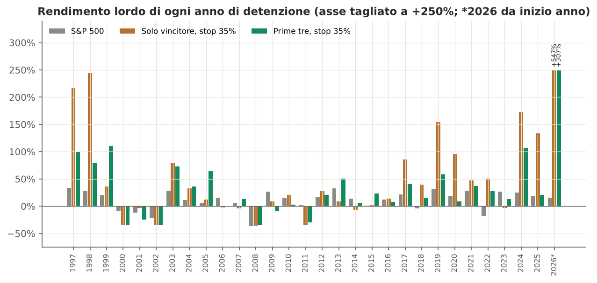
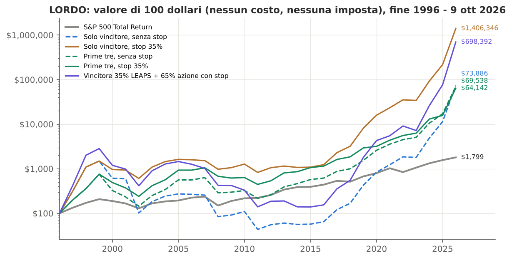
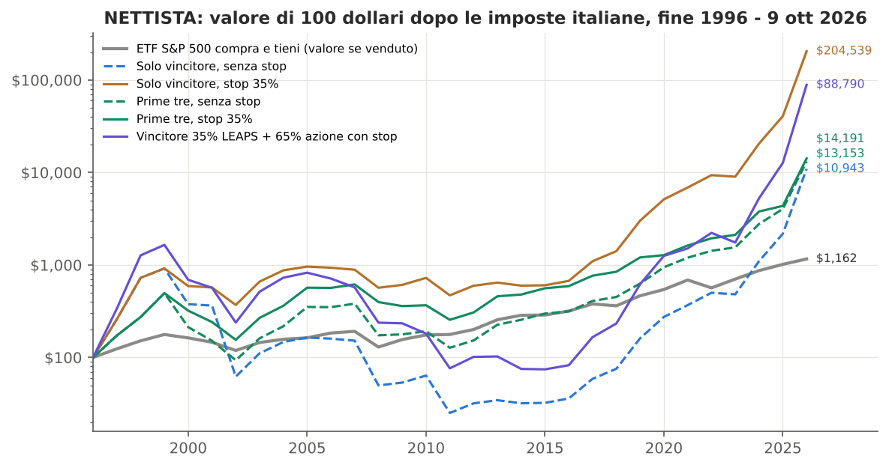
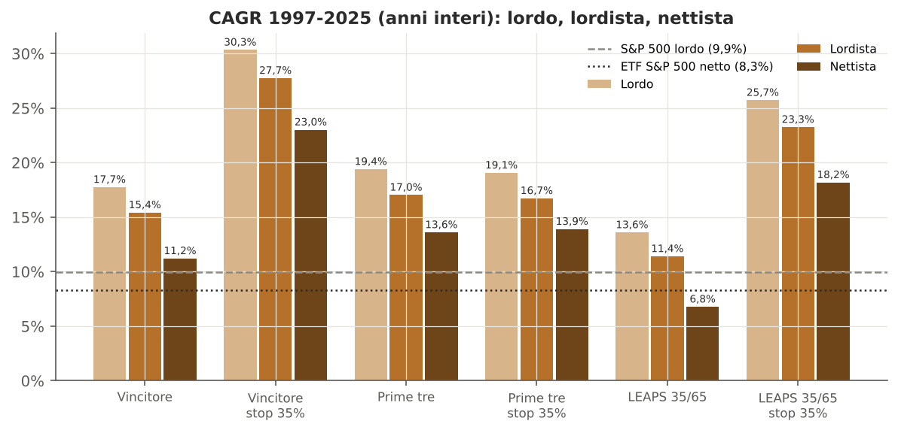

GRMS PARTNERS
Consulenza Patrimoniale Indipendente — Alta Sartoria Patrimoniale
Collana: Architettura Quantitativa
Area di competenza: Investment Advisory / Private Wealth / Tax Optimization

---

# Uno o tre titoli? La regola "January Buy" sull'S&P 500 anno per anno, con e senza stop, con LEAPS, al lordo e al netto delle imposte

## Nota di aggiornamento: versione semplificata dell'analisi 1997-2026, a confronto con l'S&P 500

*Documento riservato predisposto per il Consiglio di un family office. Dati di mercato al 9 ottobre 2026. Importi in dollari statunitensi.*

---

## Executive summary

**La domanda.** Il committente ha chiesto di riportare l'analisi alla regola nella sua forma più semplice: ogni gennaio si comprano il titolo dell'S&P 500 con il miglior rendimento dell'anno precedente, oppure i primi tre a un terzo ciascuno; si vende a fine anno e si reinveste tutto nella nuova classifica. Le domande sono quattro:

1. conviene comprare un titolo solo o tre;
2. con o senza uno stop al 35% dal prezzo di acquisto;
3. se conviene sostituire una parte dell'azione con opzioni LEAPS (35% del capitale in premi, 65% nell'azione);
4. come cambia tutto al lordo, dentro un certificato a gestione attiva (AMC) che rinvia l'imposta alla fine (vista lordista) e per un investitore nettista, a confronto con il semplice acquisto dell'S&P 500.

La nota non ripete le varianti del documento principale (12 tranche mensili, quota in ETF), escluse su indicazione del committente.

**Il risultato sull'intero periodo.** La tabella riporta i 29 anni interi dal 1997 al 2025. Il 2026, in corso, è trattato a parte perché da solo moltiplica per 6,5 il capitale della regola sul solo vincitore (Sandisk, +547% da inizio anno).

| Strategia | Lordo: CAGR | Lordista: CAGR | Nettista: CAGR | Nettista: 100 $ diventano | Peggior anno (lordo) | Max calo da picco, fine anno (lordo) |
|---|---|---|---|---|---|---|
| S&P 500 | 9,9% | 8,3% | 8,3% | 1.016 | -37,0% | -37,6% |
| Solo vincitore, senza stop | 17,7% | 15,4% | 11,2% | 2.175 | -82,9% | -97,1% |
| Solo vincitore, stop 35% | 30,3% | 27,7% | 23,0% | 40.657 | -35,9% | -59,2% |
| Prime tre, senza stop | 19,4% | 17,0% | 13,6% | 4.037 | -57,0% | -80,9% |
| Prime tre, stop 35% | 19,1% | 16,7% | 13,9% | 4.355 | -35,3% | -68,2% |
| Vincitore, 35% LEAPS + 65% azione | 13,6% | 11,4% | 6,8% | 669 | -88,9% | -99,7% |
| Vincitore, 35% LEAPS + 65% azione con stop | 25,7% | 23,3% | 18,2% | 12.702 | -58,3% | -95,1% |

*CAGR: rendimento medio annuo composto. Lordo: nessun costo e nessuna imposta. Lordista: strategia detenuta in un AMC con costo annuo dello 0,5%, imposta del 26% pagata una sola volta alla fine. Nettista: imposta del 26% sulle plusvalenze realizzate ogni anno, con compensazione delle minusvalenze entro quattro anni. Per l'S&P 500 le colonne lordista e nettista si riferiscono a un ETF UCITS tenuto per tutto il periodo. "100 $ diventano" è il valore finale dopo tutte le imposte. Max calo da picco: perdita massima tra due valori di fine anno.*

**Le risposte.**

1. **Uno o tre titoli.** Senza stop, tre titoli sono migliori sotto ogni profilo: rendono di più (13,6% contro 11,2% annuo per il nettista) e perdono molto meno (peggior anno -57% contro -83%). Con lo stop, il solo vincitore rende molto di più (23,0% contro 13,9% annuo per il nettista) con un rischio misurato simile. Il suo vantaggio però poggia su pochi episodi, come spiegano i punti 2 e 5.
2. **Lo stop al 35%.** Sul titolo singolo lo stop è decisivo: trasforma un -83% in un -35% e porta il rendimento lordo dal 17,7% al 30,3% annuo. È però scattato solo quattro volte in 29 anni, e tutte e quattro le volte ha evitato una perdita maggiore. Sulle prime tre lo stop è neutro sull'intero periodo e dannoso dopo il 2009: sui due titoli diversi dal vincitore ha evitato una perdita maggiore 7 volte su 18.
3. **LEAPS 35/65.** Nell'ipotesi di prezzo centrale rendono meno della sola azione in ogni versione e in ogni vista fiscale: per il nettista 6,8% contro 11,2% senza stop e 18,2% contro 23,0% con stop. Il risultato non migliora con LEAPS a scadenza più lunga. Solo nell'ipotesi di prezzo più favorevole pareggiano o superano di poco l'azione. Lo Studio non le raccomanda.
4. **Lordista o nettista.** Pagare l'imposta ogni anno costa alle strategie tra 2,8 e 5,1 punti di rendimento annuo, già dopo aver dedotto dal lordista il costo dell'AMC (0,5% annuo). All'ETF S&P 500 tenuto in portafoglio non costa nulla, perché l'imposta si paga comunque solo alla vendita. Il fisco riduce quindi il vantaggio delle strategie sull'indice: per le prime tre con stop il vantaggio passa da 8,4 punti annui per il lordista a 5,6 per il nettista.
5. **Confronto con l'S&P 500 nel tempo.** Sull'intero periodo tutte le strategie, salvo le LEAPS senza stop, battono l'S&P 500 anche al netto delle imposte. Su orizzonti di dieci anni il quadro cambia: le due versioni con stop battono l'ETF al netto delle imposte in 10 finestre su 20. Delle dieci finestre decennali iniziate tra il 2000 e il 2009, il solo vincitore con stop ne perde 9 e le prime tre con stop tutte e 10.

**Conclusione.** Sul piano dei numeri la versione migliore è il solo vincitore con stop al 35%. Sul piano della robustezza il quadro è meno netto, per tre ragioni:

- il vantaggio dello stop sul titolo singolo poggia su quattro episodi;
- gennaio è stato il più favorevole dei dodici mesi di partenza possibili;
- per dieci anni consecutivi di partenze, dal 2000 al 2009, la regola ha reso meno dell'ETF nel decennio successivo.

Tre titoli hanno senso se la famiglia vuole ridurre il rischio legato a una singola società. Nel campione questo costa circa 9 punti di rendimento netto annuo. In ogni caso la regola va applicata con lo stop e senza LEAPS, possibilmente dentro un AMC che rinvii l'imposta alla fine. Non va presentata come un modo sicuro di battere l'S&P 500: in metà dei decenni esaminati non lo ha fatto.

---

## 1. Regole, dati e tre modi di contare

### 1.1 Le regole

- **Classifica.** Alla fine di ogni anno T0 i membri dell'S&P 500 sono ordinati per rendimento totale dell'anno solare, dividendi inclusi. La composizione dell'indice è quella storica di ogni data. Sono inclusi i titoli che oggi non esistono più.
- **Acquisto e vendita.** Si compra all'apertura del primo giorno di borsa dell'anno T0+1 e si vende alla chiusura dell'ultimo giorno di borsa dello stesso anno. L'intero capitale viene reinvestito nella classifica successiva.
- **Solo vincitore.** 100% del capitale sul primo classificato.
- **Prime tre.** Un terzo del capitale su ciascuno dei primi tre, senza ribilanciamenti durante l'anno.
- **Stop al 35%.** Si vende quando il prezzo tocca il 65% del prezzo di acquisto, controllando i minimi giornalieri. La vendita avviene al livello dello stop o, se il titolo apre già sotto, al prezzo di apertura. Il ricavato resta in liquidità, senza interessi, fino a fine anno. Nelle prime tre lo stop chiude solo il titolo che scende; se scatta su tutti e tre, l'intero portafoglio passa in liquidità.
- **LEAPS 35/65.** Sul solo vincitore, il 65% del capitale compra l'azione e il 35% compra opzioni call di lungo periodo sulla stessa azione (sezione 5).
- **2026.** L'anno in corso è misurato dal 2 gennaio al 9 ottobre 2026.

### 1.2 Dati

I dati sono gli stessi del documento principale:

- composizione storica dell'S&P 500 dal 1996;
- prezzi giornalieri con dividendi, inclusi i titoli usciti dal listino;
- indice S&P 500 Total Return come riferimento lordo.

Nove titoli della top-3 assenti dai dati gratuiti sono stati ricostruiti dai documenti depositati alla SEC (proxy statement e 10-K) e dalle liste pubbliche dei migliori titoli dell'anno. Nelle tabelle sono indicati con un asterisco. La top-3 degli anni 1996-2008, quando i dati coprono meno del 95% dei membri dell'indice, è stata confrontata con quelle fonti indipendenti. Due valori restano da verificare: il rendimento 2001 di Reebok e quello 2004 di Avaya. In nessuno dei due casi lo stop è toccato. [DA VERIFICARE: rendimento totale esatto Reebok 2001 e Avaya 2004.]

Nessun titolo della top-3 è fallito nell'anno di detenzione. L'unico uscito dal listino durante l'anno è UST, acquistata in contanti da Altria il 6 gennaio 2009. Il peggior anno di detenzione è quello di Nvidia nel 2002: -82,9%.

### 1.3 Tre modi di contare

| Voce | Lordo | Lordista | Nettista |
|---|---|---|---|
| Costi di negoziazione | nessuno | 0,10% a ogni acquisto e vendita | 0,10% a ogni acquisto e vendita |
| Costo del contenitore | nessuno | 0,50% annuo (AMC); non applicato all'ETF S&P 500 | nessuno |
| Imposta di bollo | nessuna | 0,20% annuo | 0,20% annuo |
| Dividendi di società USA | interi | ritenuta USA del 15% | 37,1% complessivo (15% USA più 26% italiano sul netto), non compensabile |
| Plusvalenze | nessuna imposta | 26% una sola volta, sul guadagno complessivo alla fine | 26% ogni anno sulle plusvalenze realizzate |
| Minusvalenze | - | compensate implicitamente nel risultato finale | compensabili con le plusvalenze dei quattro anni successivi, poi perse |
| S&P 500 di confronto | indice Total Return | ETF UCITS tenuto per tutto il periodo (costo annuo 0,07%, ritenuta del 15% nel fondo), 26% alla vendita | lo stesso ETF; in più, l'ETF venduto e ricomprato ogni anno |

Il lordista detiene la strategia dentro un certificato a gestione attiva (AMC), emesso da una banca e gestito secondo la regola. Il cliente possiede il certificato, non i singoli titoli: le vendite e i riacquisti di ogni gennaio avvengono dentro il certificato e non generano imposta per il cliente. Il 26% si paga sul guadagno complessivo quando il certificato viene venduto o rimborsato. Il calcolo deduce ogni anno un costo dell'AMC dello 0,5%, in aggiunta ai costi di negoziazione e all'imposta di bollo, che si applica anche ai certificati. L'ETF S&P 500 di confronto è invece detenuto direttamente e non sostiene questo costo. [DA VERIFICARE: trattamento fiscale dello specifico AMC (proventi come redditi diversi, imposta solo alla vendita o al rimborso), costo effettivo proposto dall'emittente, ritenuta USA applicata ai dividendi dentro il certificato.]

Le aliquote e le regole fiscali sono quelle verificate nel documento principale. Le voci lì indicate come [DA VERIFICARE] restano tali. Le regole vigenti nel 2026 sono applicate a tutto il periodo.

**L'asimmetria che conta.** Per l'ETF S&P 500 tenuto in portafoglio il lordista e il nettista coincidono: in entrambi i casi l'imposta si paga una sola volta, alla vendita. Per la regola invece il nettista paga ogni anno sull'intera plusvalenza. Il fisco penalizza quindi la strategia ma non il suo termine di confronto.

Tutti gli importi sono in dollari. Per un investitore in euro i risultati cambiano con il cambio, e le plusvalenze imponibili si calcolano in euro. Il documento principale riporta i risultati in euro.

---

## 2. I primi tre titoli di ogni anno

La tabella riporta, per ogni anno T0, i tre titoli migliori dell'S&P 500, il loro rendimento nell'anno T0 e quello nell'anno successivo, quando la regola li detiene. Tra parentesi è indicato il rendimento effettivo quando lo stop al 35% è scattato.

| Anno T0 | 1° classificato | 2° classificato | 3° classificato |
|---|---|---|---|
| 1996 | Dell (1988-2013): +207% → +216% | TJX Companies: +154% → +48% | Rowan Companies: +135% → +33% |
| 1997 | Dell (1988-2013): +216% → +245% | Navistar International: +161% → +15% | Cincinnati Financial: +121% → -20% |
| 1998 | Dell (1988-2013): +249% → +36% | Apple Inc.: +212% → +144% | EMC Corp.: +210% → +152% |
| 1999 | Qualcomm: +2619% → -59% (stop: -35%) | Sprint PCS Group*: +343% → -60% (stop: -35%) | Nextel Communications*: +337% → -52% (stop: -35%) |
| 2000 | Reebok International*: +234% → -3% | Dynegy*: +220% → -54% (stop: -35%) | EOG Resources: +213% → -28% (stop: -35%) |
| 2001 | Nvidia: +308% → -83% (stop: -35%) | Office Depot (ODP Corp.): +160% → -19% (stop: -36%) | J.C. Penney: +155% → -12% (stop: -35%) |
| 2002 | Providian Financial*: +83% → +79% | Boston Scientific: +76% → +72% | Newmont: +53% → +68% |
| 2003 | Avaya*: +428% → +33% | Williams Companies: +266% → +67% | Dynegy*: +263% → +8% |
| 2004 | Autodesk: +210% → +12% | Apple Inc.: +201% → +122% | TXU Corp.*: +178% → +60% |
| 2005 | Valero Energy: +128% → -2% | Apple Inc.: +123% → +17% | Express Scripts: +119% → -15% |
| 2006 | ATI Inc. (Allegheny Technologies): +153% → -4% | Terex: +117% → +4% | Nvidia: +102% → +38% |
| 2007 | NOV Inc. (National Oilwell Varco): +140% → -67% (stop: -36%) | Amazon: +135% → -46% (stop: -35%) | Jacobs Solutions: +135% → -50% (stop: -35%) |
| 2008 | Family Dollar Stores: +39% → +9% | UST Inc.*: +27% → +0% | H&R Block: +26% → +2% (stop: -35%) |
| 2009 | XL Capital / XL Group: +419% → +20% | Tenet Healthcare: +369% → +23% | Advanced Micro Devices: +348% → -16% (stop: -35%) |
| 2010 | Netflix: +219% → -60% (stop: -35%) | F5, Inc.: +146% → -20% (stop: -35%) | Cummins: +143% → -20% |
| 2011 | Coterra Energy (ex Cabot Oil & Gas): +101% → +28% | Intuitive Surgical: +80% → +4% | Mastercard: +67% → +30% |
| 2012 | PulteGroup: +188% → +9% | Sprint Nextel / Sprint Corp.: +142% → +88% | Whirlpool: +120% → +54% |
| 2013 | Netflix: +298% → -7% | Best Buy: +244% → +0% (stop: -35%) | Micron Technology: +243% → +61% |
| 2014 | Southwest Airlines: +126% → +2% | Electronic Arts Inc: +105% → +46% | Edwards Lifesciences: +94% → +23% |
| 2015 | Netflix: +134% → +14% | Amazon: +118% → +14% | Activision Blizzard: +94% → -4% |
| 2016 | Nvidia: +227% → +86% | Oneok: +150% → -3% | Freeport-McMoRan: +95% → +41% |
| 2017 | NRG Energy: +134% → +39% | Align Technology: +131% → -6% | Vertex Pharmaceuticals: +103% → +10% |
| 2018 | Advanced Micro Devices: +80% → +155% | Abiomed: +73% → -46% (stop: -35%) | Fortinet: +61% → +56% |
| 2019 | Advanced Micro Devices: +148% → +96% | Lam Research: +119% → +62% (stop: -35%) | KLA Corporation: +104% → +46% (stop: -35%) |
| 2020 | Tesla, Inc.: +743% → +47% | Etsy: +302% → +22% | Carrier Global: +217% → +43% |
| 2021 | Devon Energy: +196% → +51% | Marathon Oil: +150% → +67% | Bath & Body Works (ex L Brands): +144% → -38% (stop: -35%) |
| 2022 | Occidental Petroleum: +119% → -3% | Constellation Energy: +107% → +38% | Hess Corporation: +94% → +4% |
| 2023 | Nvidia: +239% → +173% | Meta Platforms: +194% → +67% | Royal Caribbean Group: +162% → +82% |
| 2024 | Palantir Technologies: +340% → +133% | Vistra Corp.: +262% → +16% (stop: -35%) | Nvidia: +171% → +37% (stop: -36%) |
| 2025 | Sandisk: +559% → +547% | Western Digital: +286% → +124% | Micron Technology: +240% → +249% |

*Il rendimento dell'anno T0 è il rendimento totale dell'anno solare; quello dell'anno successivo va dall'apertura del primo giorno di borsa alla chiusura dell'ultimo. Per il 2025 il rendimento successivo è quello del 2026 fino al 9 ottobre. Asterisco: serie ricostruita dai documenti SEC. Le date tra parentesi nei nomi distinguono società diverse con lo stesso nome.*

**Che cosa mostra la tabella.** Dal 1997 al 2025 la regola ha detenuto 87 posizioni:

- nell'anno della classifica la mediana dei rendimenti è stata +150%;
- nell'anno successivo la mediana scende a +17%;
- 59 posizioni su 87 hanno chiuso l'anno successivo in guadagno;
- 11 hanno perso più del 30%.

Il primo classificato ha reso in mediana il 20% nell'anno successivo, contro il 16% del secondo e il 23% del terzo. Un rendimento più alto nell'anno della classifica non ha indicato un rendimento più alto l'anno dopo: Qualcomm, salita del 2.619% nel 1999, ha perso il 59% nel 2000.

---

## 3. Il rendimento del portafoglio anno per anno

La tabella riporta il rendimento lordo di ogni anno di detenzione. I rendimenti anno per anno nelle viste lordista e nettista sono nelle Appendici A e B.

| Anno | S&P 500 | Vincitore | Vincitore, stop | Prime tre | Prime tre, stop | Fermati su 3 | LEAPS 35/65 | LEAPS 35/65, stop |
|---|---|---|---|---|---|---|---|---|
| 1997 | +33,4% | +216,2% | +216,2% | +99,1% | +99,1% | 0 | +323,0% | +323,0% |
| 1998 | +28,6% | +245,2% | +245,2% | +80,0% | +80,0% | 0 | +375,6% | +375,6% |
| 1999 | +21,0% | +36,2% | +36,2% | +110,8% | +110,8% | 0 | +40,9% | +40,9% |
| 2000 | -9,1% | -58,8% | -35,3% | -57,0% | -35,1% | 3 | -73,2% | -57,9% |
| 2001 | -11,9% | -3,1% | -3,1% | -28,4% | -24,4% | 2 | -17,7% | -17,7% |
| 2002 | -22,1% | -82,9% | -35,0% | -38,0% | -35,3% | 3 | -88,9% | -57,7% |
| 2003 | +28,7% | +79,4% | +79,4% | +73,2% | +73,2% | 0 | +116,3% | +116,3% |
| 2004 | +10,9% | +33,0% | +33,0% | +35,9% | +35,9% | 0 | +42,3% | +42,3% |
| 2005 | +4,9% | +12,2% | +12,2% | +64,7% | +64,7% | 0 | +13,8% | +13,8% |
| 2006 | +15,8% | -2,1% | -2,1% | +0,0% | +0,0% | 0 | -13,1% | -13,1% |
| 2007 | +5,5% | -4,3% | -4,3% | +12,6% | +12,6% | 0 | -19,3% | -19,3% |
| 2008 | -37,0% | -67,1% | -35,9% | -54,3% | -35,3% | 3 | -78,5% | -58,3% |
| 2009 | +26,5% | +8,5% | +8,5% | +3,4% | -8,8% | 1 | -0,8% | -0,8% |
| 2010 | +15,1% | +20,3% | +20,3% | +8,9% | +2,7% | 1 | -21,7% | -21,7% |
| 2011 | +2,1% | -60,4% | -35,0% | -33,4% | -29,9% | 2 | -74,2% | -57,7% |
| 2012 | +16,0% | +27,6% | +27,6% | +20,6% | +20,6% | 0 | +33,5% | +33,5% |
| 2013 | +32,4% | +8,8% | +8,8% | +50,4% | +50,4% | 0 | +1,6% | +1,6% |
| 2014 | +13,7% | -6,9% | -6,9% | +18,3% | +6,5% | 1 | -26,3% | -26,3% |
| 2015 | +1,4% | +1,6% | +1,6% | +23,5% | +23,5% | 0 | -0,6% | -0,6% |
| 2016 | +12,0% | +13,6% | +13,6% | +7,8% | +7,8% | 0 | +11,2% | +11,2% |
| 2017 | +21,8% | +86,1% | +86,1% | +41,1% | +41,1% | 0 | +129,1% | +129,1% |
| 2018 | -4,4% | +39,1% | +39,1% | +14,6% | +14,6% | 0 | +55,5% | +55,5% |
| 2019 | +31,5% | +154,6% | +154,6% | +54,8% | +58,4% | 1 | +225,9% | +225,9% |
| 2020 | +18,4% | +95,7% | +95,7% | +67,9% | +8,6% | 2 | +139,7% | +139,7% |
| 2021 | +28,7% | +46,9% | +46,9% | +37,3% | +37,3% | 0 | +28,0% | +28,0% |
| 2022 | -18,1% | +50,6% | +50,6% | +26,3% | +27,5% | 1 | +65,5% | +65,5% |
| 2023 | +26,3% | -3,0% | -3,0% | +12,9% | +12,9% | 0 | -20,7% | -20,7% |
| 2024 | +25,0% | +172,8% | +172,8% | +107,4% | +107,4% | 0 | +263,1% | +263,1% |
| 2025 | +17,9% | +133,3% | +133,3% | +62,2% | +20,9% | 2 | +192,1% | +192,1% |
| 2026* | +15,1% | +547,4% | +547,4% | +306,9% | +306,9% | 0 | +813,2% | +813,2% |

*Rendimenti lordi: nessun costo e nessuna imposta. S&P 500: indice Total Return. "Fermati su 3": titoli delle prime tre chiusi dallo stop nell'anno. LEAPS 35/65: 35% del capitale in opzioni e 65% nell'azione del vincitore; nella versione con stop lo stop si applica alla sola parte in azioni. 2026 con asterisco: dal 2 gennaio al 9 ottobre.*

**Gli anni negativi sono concentrati nei mercati ribassisti.** Le perdite più forti cadono nel 2000, nel 2002 e nel 2008. In quei tre anni lo stop è scattato su tutti e tre i titoli e il portafoglio delle prime tre ha chiuso intorno a -35%. L'eccezione è il 2011: con il mercato in leggero rialzo, il vincitore (Netflix) ha perso il 60% senza stop.

---

## 4. Uno o tre titoli, con o senza stop

### 4.1 L'intero periodo

Sul periodo completo, incluso il 2026, i valori sono più alti per tutte le strategie, ma l'ordine non cambia.

| Strategia | Lordo: CAGR | Lordista: CAGR | Nettista: CAGR | Nettista: 100 $ diventano | Peggior anno (lordo) | Max calo da picco, fine anno (lordo) |
|---|---|---|---|---|---|---|
| S&P 500 | 10,2% | 8,6% | 8,6% | 1.162 | -37,0% | -37,6% |
| Solo vincitore, senza stop | 24,8% | 22,4% | 17,1% | 10.943 | -82,9% | -97,1% |
| Solo vincitore, stop 35% | 37,8% | 35,1% | 29,2% | 204.539 | -35,9% | -59,2% |
| Prime tre, senza stop | 24,6% | 22,1% | 17,8% | 13.153 | -57,0% | -80,9% |
| Prime tre, stop 35% | 24,2% | 21,8% | 18,1% | 14.191 | -35,3% | -68,2% |
| Vincitore, 35% LEAPS + 65% azione | 22,0% | 19,6% | 13,8% | 4.678 | -88,9% | -99,7% |
| Vincitore, 35% LEAPS + 65% azione con stop | 34,6% | 32,0% | 25,6% | 88.790 | -58,3% | -95,1% |

*1997-9 ottobre 2026: 29,8 anni. Il 2026 vale +547% per il solo vincitore, +307% per le prime tre e +15% per l'S&P 500.*

### 4.2 Due periodi molto diversi

| Strategia | 1997-2008 lordo | 1997-2008 nettista | 2009-2025 lordo | 2009-2025 nettista | 2009-2026 (YTD) lordo | 2009-2026 (YTD) nettista |
|---|---|---|---|---|---|---|
| S&P 500 | 3,4% | 2,2% | 14,8% | 12,4% | 15,0% | 12,7% |
| Solo vincitore, senza stop | -1,4% | -5,6% | 33,5% | 24,5% | 46,4% | 35,0% |
| Solo vincitore, stop 35% | 20,9% | 15,6% | 37,4% | 28,1% | 50,6% | 38,8% |
| Prime tre, senza stop | 9,2% | 4,7% | 27,1% | 20,0% | 36,2% | 27,2% |
| Prime tre, stop 35% | 17,3% | 12,2% | 20,3% | 14,9% | 29,2% | 22,1% |
| Vincitore, 35% LEAPS + 65% azione | -8,0% | -12,3% | 31,8% | 22,7% | 47,5% | 35,7% |
| Vincitore, 35% LEAPS + 65% azione con stop | 12,8% | 7,5% | 35,7% | 26,4% | 51,7% | 39,6% |

*CAGR. Lordo: S&P 500 contro indice Total Return. Nettista: S&P 500 contro ETF tenuto in portafoglio, dopo l'imposta finale.*

Le due metà del campione raccontano storie opposte.

- **1997-2008.** È un periodo di bolla e di due mercati ribassisti. Senza stop il solo vincitore perde denaro (-1,4% annuo lordo), mentre le prime tre guadagnano il 9,2% grazie alla diversificazione. Con lo stop entrambe le versioni battono nettamente l'S&P 500, che rende il 3,4%. Lo stop è la variabile decisiva.
- **2009-2025.** È un mercato quasi sempre in rialzo, guidato da pochi grandi titoli tecnologici. Il solo vincitore rende più delle prime tre in tutte le versioni. Lo stop aggiunge poco al vincitore (dal 33,5% al 37,4%) e toglie molto alle prime tre (dal 27,1% al 20,3%). Per il nettista il vantaggio delle prime tre con stop sull'ETF si riduce a 2,5 punti annui.

### 4.3 Quanto il risultato dipende da pochi anni

| Strategia | CAGR lordo 1997-2025 | CAGR senza i 3 anni migliori | I 3 anni migliori | Anni in perdita (su 29) | Anni sopra l'S&P 500 (su 29) |
|---|---|---|---|---|---|
| S&P 500 | 9,9% | 7,6% | 1997, 2013, 2019 | 6 | - |
| Solo vincitore, senza stop | 17,7% | 5,3% | 1997, 1998, 2024 | 9 | 19 |
| Solo vincitore, stop 35% | 30,3% | 17,9% | 1997, 1998, 2024 | 9 | 20 |
| Prime tre, senza stop | 19,4% | 12,1% | 1997, 1999, 2024 | 5 | 19 |
| Prime tre, stop 35% | 19,1% | 11,8% | 1997, 1999, 2024 | 6 | 18 |
| Vincitore, 35% LEAPS + 65% azione | 13,6% | -2,3% | 1997, 1998, 2024 | 12 | 14 |
| Vincitore, 35% LEAPS + 65% azione con stop | 25,7% | 9,5% | 1997, 1998, 2024 | 12 | 14 |

*Rendimenti lordi 1997-2025. Il CAGR senza i 3 anni migliori è calcolato sui 26 anni restanti. Ogni strategia è misurata senza i propri tre anni migliori.*

Il solo vincitore con stop resta sopra l'S&P 500 anche togliendo i suoi tre anni migliori: 17,9% contro 9,9%. Senza stop, invece, il solo vincitore scende al 5,3%, sotto l'indice. La regola senza stop vive quindi di pochi anni eccezionali. Lo stop le dà una base più solida, perché taglia le perdite degli anni peggiori.

### 4.4 Lo stop: dove ha aiutato e dove ha fatto danni

Dal 1997 al 2025 lo stop è scattato 22 volte su 87 posizioni. Nel 2026, finora, non è scattato.

| Anno di detenzione | Posizione | Società | Data dello stop | Senza stop | Con stop | Apertura sotto lo stop | Effetto dello stop |
|---|---|---|---|---|---|---|---|
| 2000 | 1° | Qualcomm | 26-01-2000 | -58,8% | -35,3% | si | ha evitato una perdita maggiore |
| 2000 | 2° | Sprint PCS Group* | 15-09-2000 | -60,1% | -35,0% | no | ha evitato una perdita maggiore |
| 2000 | 3° | Nextel Communications* | 10-11-2000 | -52,0% | -35,0% | no | ha evitato una perdita maggiore |
| 2001 | 2° | Dynegy* | 17-09-2001 | -54,2% | -35,0% | no | ha evitato una perdita maggiore |
| 2001 | 3° | EOG Resources | 28-06-2001 | -27,9% | -35,0% | no | ha peggiorato il risultato |
| 2002 | 1° | Nvidia | 28-03-2002 | -82,9% | -35,0% | no | ha evitato una perdita maggiore |
| 2002 | 2° | Office Depot (ODP Corp.) | 22-07-2002 | -18,9% | -36,0% | si | ha peggiorato il risultato |
| 2002 | 3° | J.C. Penney | 15-07-2002 | -12,2% | -35,0% | no | ha peggiorato il risultato |
| 2008 | 1° | NOV Inc. (National Oilwell Varco) | 16-09-2008 | -67,1% | -35,9% | si | ha evitato una perdita maggiore |
| 2008 | 2° | Amazon | 03-03-2008 | -46,2% | -35,0% | no | ha evitato una perdita maggiore |
| 2008 | 3° | Jacobs Solutions | 05-09-2008 | -49,7% | -35,0% | no | ha evitato una perdita maggiore |
| 2009 | 3° | H&R Block | 28-04-2009 | +1,8% | -35,0% | no | ha peggiorato il risultato |
| 2010 | 3° | Advanced Micro Devices | 12-08-2010 | -16,4% | -35,1% | si | ha peggiorato il risultato |
| 2011 | 1° | Netflix | 29-09-2011 | -60,4% | -35,0% | no | ha evitato una perdita maggiore |
| 2011 | 2° | F5, Inc. | 05-08-2011 | -20,1% | -35,0% | no | ha peggiorato il risultato |
| 2014 | 2° | Best Buy | 16-01-2014 | +0,4% | -35,0% | no | ha peggiorato il risultato |
| 2019 | 2° | Abiomed | 01-08-2019 | -46,0% | -35,0% | no | ha evitato una perdita maggiore |
| 2020 | 2° | Lam Research | 18-03-2020 | +62,3% | -35,0% | no | ha peggiorato il risultato |
| 2020 | 3° | KLA Corporation | 20-03-2020 | +45,8% | -35,0% | no | ha peggiorato il risultato |
| 2022 | 3° | Bath & Body Works (ex L Brands) | 06-04-2022 | -38,5% | -35,0% | no | ha evitato una perdita maggiore |
| 2025 | 2° | Vistra Corp. | 07-04-2025 | +16,2% | -35,0% | no | ha peggiorato il risultato |
| 2025 | 3° | Nvidia | 07-04-2025 | +37,2% | -35,7% | si | ha peggiorato il risultato |

*"Apertura sotto lo stop": il titolo ha aperto sotto il livello e la vendita è avvenuta al prezzo di apertura. Asterisco: serie ricostruita, con lo stop ricavato dai minimi trimestrali del 10-K.*

Tre fatti emergono dalla tabella.

1. **Il bilancio complessivo è in pareggio.** Lo stop ha evitato una perdita maggiore 11 volte su 22 e ha peggiorato il risultato nelle altre 11. Gli stop dannosi più costosi sono quelli del marzo 2020 (Lam Research e KLA, che hanno poi chiuso l'anno a +62% e +46%) e dell'aprile 2025 (Vistra e Nvidia).
2. **Sul vincitore lo stop ha funzionato 4 volte su 4.** Qualcomm 2000, Nvidia 2002, NOV 2008 e Netflix 2011: in tutti e quattro i casi il titolo ha chiuso l'anno tra -59% e -83%. È l'origine dell'intero vantaggio del solo vincitore con stop. Quattro episodi sono però un campione piccolo: basterebbe uno stop scattato su un vincitore poi risalito per ridurre il vantaggio in modo sensibile.
3. **L'apertura sotto lo stop è un rischio reale ma contenuto nel campione.** È successo 5 volte; la vendita peggiore è avvenuta a -36,0%. Una singola società può però perdere molto di più in una notte, per esempio dopo una frode contabile o l'esito negativo di una sperimentazione clinica. Il campione di 29 vincitori non contiene un caso del genere. Con tre titoli lo stesso evento peserebbe per un terzo.

### 4.5 La fortuna del calendario

Il documento principale ha ripetuto la stessa regola con partenza in ciascuno dei dodici mesi dell'anno, dal 2009 al 9 ottobre 2026. Quei risultati sono calcolati in euro e al netto del fisco italiano, quindi non sono direttamente confrontabili con le tabelle di questa nota. Gennaio vi risulta il mese di partenza più favorevole:

| Nettista, euro, 2009 - 9 ottobre 2026 | Partenza a gennaio | Mese mediano | Mese peggiore |
|---|---|---|---|
| Solo vincitore, stop 35% | 40,4% (1° su 12) | 15,1% | -10,1% (aprile) |
| Prime tre, stop 35% | 23,4% (2° su 12) | 12,8% | +6,8% (maggio) |
| ETF S&P 500, compra e tieni | 13,8% | - | - |

*Fonte: documento principale, foglio "G3_timing_luck" dell'Excel dei risultati.*

Con un mese di partenza qualsiasi, il vantaggio del solo vincitore con stop sull'ETF si riduce a poco più di un punto annuo. Partendo ad aprile, la stessa regola avrebbe perso denaro in quasi 18 anni. Le prime tre con stop non hanno mai perso denaro in nessun mese di partenza. Con un mese di partenza tipico, però, hanno reso poco meno dell'ETF.

### 4.6 Valutazione: uno o tre?

- **Senza stop: tre titoli.** Rendono di più e perdono molto meno. Il solo vincitore senza stop è la versione peggiore tra quelle in azioni: perde il 97% dal massimo e senza i tre anni migliori rende meno dell'indice.
- **Con stop: il vincitore rende di più, tre titoli sono più robusti.** Nel campione il solo vincitore con stop ha reso circa 9 punti annui in più delle prime tre con stop, con un peggior anno simile (-35,9% contro -35,3%) e un calo massimo dal picco meno profondo (-59% contro -68%). Ha però tre debolezze che il risultato medio non mostra:
  - dipende da quattro stop andati tutti nella direzione giusta;
  - è esposto senza diversificazione all'evento estremo su una singola società;
  - fuori da gennaio il suo risultato può essere molto peggiore.
- **Conclusione dello Studio.** Se la famiglia accetta il rischio di una sola società per anno, il solo vincitore con stop è la versione con il rendimento atteso più alto. Se lo considera eccessivo per il patrimonio di famiglia, le prime tre con stop sono la versione difendibile. Il prezzo è un rendimento atteso più basso, che fuori da gennaio è stato vicino a quello dell'ETF.

---

## 5. LEAPS: 35% in premi e 65% nell'azione

### 5.1 Come è costruita la posizione

Le LEAPS sono opzioni call quotate con scadenza lunga. La posizione esaminata è la seguente:

- il 65% del capitale compra l'azione del vincitore;
- il 35% compra call sulla stessa azione, con scadenza a gennaio dell'anno successivo a quello di detenzione, cioè circa un anno;
- lo strike è scelto in modo che ogni opzione costi il 35% del prezzo dell'azione;
- tutto viene venduto a fine anno insieme all'azione, quando all'opzione restano circa tre settimane di vita.

Con questa scelta, il 35% del capitale compra opzioni su tante azioni quante se ne comprerebbero con il 100% del capitale. Nel campione lo strike mediano è al 76% del prezzo: l'opzione è quindi già "in the money" all'acquisto. L'esposizione complessiva all'azione è di circa 1,5 volte il capitale.

**Prezzi stimati.** Non esistono prezzi storici gratuiti delle LEAPS per questi titoli, e per alcuni titoli negli anni più lontani le LEAPS potrebbero non essere state quotate. [DA VERIFICARE: esistenza di LEAPS quotate sui vincitori del periodo 1997-2003.] I prezzi sono quindi stimati con il modello di Black-Scholes, con queste ipotesi:

- volatilità implicita pari alla volatilità realizzata dell'ultimo anno moltiplicata per 1,1, con un minimo del 20%;
- costo di 3% sul prezzo dell'opzione a ogni acquisto e vendita, per la differenza tra prezzo denaro e lettera;
- valore di uscita calcolato con la volatilità degli ultimi tre mesi.

Per le tre serie ricostruite la volatilità è la mediana dei vincitori: 53%. La volatilità implicita mediana all'acquisto è del 57%.

Lo stop si applica alla sola parte in azioni. L'opzione è tenuta fino a fine anno: la sua perdita massima è comunque il premio pagato.

### 5.2 Risultati

| Ipotesi di prezzo | Stop sull'azione | 1997-2025 lordo | 1997-2025 nettista | 2009-2025 lordo | 2009-2025 nettista |
|---|---|---|---|---|---|
| Ottimista (IV 0,9x, spread 1%) | no | 18,7% | 11,2% | 39,8% | 29,4% |
| Ottimista (IV 0,9x, spread 1%) | si | 31,4% | 23,1% | 44,0% | 33,2% |
| Centrale (IV 1,1x, spread 3%) | no | 13,6% | 6,8% | 31,8% | 22,7% |
| Centrale (IV 1,1x, spread 3%) | si | 25,7% | 18,2% | 35,7% | 26,4% |
| Prudente (IV 1,3x, spread 6%) | no | 8,1% | 2,2% | 24,0% | 16,4% |
| Prudente (IV 1,3x, spread 6%) | si | 19,7% | 13,1% | 27,6% | 19,9% |
| Centrale, LEAPS a 2 anni venduta dopo 1 anno | no | 13,2% | 6,8% | 27,5% | 19,3% |
| Centrale, LEAPS a 2 anni venduta dopo 1 anno | si | 23,6% | 16,7% | 30,5% | 22,1% |
| Solo azione (confronto) | no | 17,7% | 11,2% | 33,5% | 24,5% |
| Solo azione (confronto) | si | 30,3% | 23,0% | 37,4% | 28,1% |

*CAGR su anni interi. Ottimista: volatilità implicita 0,9 volte la realizzata e costo dell'1%. Prudente: 1,3 volte e 6%. LEAPS a 2 anni: opzione con scadenza circa due anni, venduta dopo un anno con un anno di vita residua. "Solo azione": 100% nell'azione del vincitore, per confronto.*

**Le LEAPS non migliorano la regola.**

- Nell'ipotesi centrale la versione 35/65 rende meno della sola azione in tutti i casi e in tutte le viste fiscali.
- Con LEAPS a due anni il risultato non migliora. A parità di premio lo strike è più alto, e l'opzione diventa meno sensibile all'azione.
- Solo nell'ipotesi più favorevole, con opzioni a buon mercato e costi minimi, la versione 35/65 pareggia o supera di poco la sola azione: 31,4% contro 30,3% lordo con stop, 23,1% contro 23,0% per il nettista. Un vantaggio che dipende dall'ipotesi più ottimistica non è un vantaggio su cui costruire.

**Perché.** Il rendimento anno per anno è nell'Appendice C.

- **Soglia di guadagno.** Con lo strike tipico al 76% del prezzo, l'opzione guadagna solo se l'azione sale di oltre il 13% circa entro fine anno, perché il valore temporale pagato all'acquisto si esaurisce. In cinque anni l'azione è salita e l'opzione ha perso (2009, 2010, 2013, 2015, 2021).
- **Azzeramenti.** Nei cinque anni in cui il vincitore è sceso molto o non è salito abbastanza (2000, 2002, 2008, 2010, 2011) l'opzione ha perso tra il 99,7% e il 100%. Lo stop protegge l'azione, non l'opzione.
- **Leva sul rendimento, non sulla qualità.** La leva amplifica gli anni ottimi (1997-1998, 2017-2020, 2024-2025 e il 2026) ma moltiplica anche quelli negativi. Sui 29 anni interi la versione 35/65 batte la sola azione in 14 anni e perde negli altri 15. Il saldo finale è negativo.
- **Fisco.** Le perdite sulle opzioni generano minusvalenze che spesso scadono prima di essere usate. Il nettista ne perde per 1.642 dollari su 100 investiti senza stop (sezione 6).

---

## 6. Lordista o nettista: quanto costa il fisco

| Strategia | Lordista: 100 $ diventano | Nettista: 100 $ diventano | Imposte pagate nel tempo, nettista ($) | Minusvalenze perse per scadenza ($) | Differenza di CAGR lordista - nettista (punti) |
|---|---|---|---|---|---|
| Solo vincitore, senza stop | 6.403 | 2.175 | 1.051 | 882 | 4,2 |
| Solo vincitore, stop 35% | 121.407 | 40.657 | 14.545 | 325 | 4,7 |
| Prime tre, senza stop | 9.562 | 4.037 | 1.525 | 323 | 3,4 |
| Prime tre, stop 35% | 8.863 | 4.355 | 1.587 | 160 | 2,8 |
| Vincitore, 35% LEAPS + 65% azione | 2.290 | 669 | 782 | 1.642 | 4,6 |
| Vincitore, 35% LEAPS + 65% azione con stop | 43.003 | 12.702 | 5.010 | 1.543 | 5,1 |

*1997-2025. "100 $ diventano": valore finale dopo tutte le imposte; per il lordista, dopo l'imposta finale del 26%. Imposte pagate e minusvalenze scadute: somme nominali in dollari nel corso dei 29 anni, su 100 dollari iniziali.*

**Il costo del fisco annuo è grande e cresce con il rendimento.** Anche dopo il costo dell'AMC, il nettista perde tra 2,8 e 5,1 punti di rendimento annuo rispetto al lordista. Sul solo vincitore con stop il valore finale netto è 40.657 dollari contro 121.407 del lordista: il 33%. Il costo non sta nell'aliquota, che è la stessa. Sta nel fatto che il 26% viene sottratto ogni anno al capitale che dovrebbe comporsi l'anno dopo.

**Il confronto con l'S&P 500 va fatto nella stessa vista.** L'ETF S&P 500 tenuto in portafoglio rende l'8,3% annuo sia per il lordista sia per il nettista. Il vantaggio delle strategie si riduce quindi passando dal lordista al nettista (tabella seguente).

| Vantaggio annuo sull'ETF S&P 500, 1997-2025 | Lordista | Nettista |
|---|---|---|
| Solo vincitore, senza stop | 7,1 punti | 2,9 punti |
| Solo vincitore, stop 35% | 19,4 punti | 14,7 punti |
| Prime tre, senza stop | 8,7 punti | 5,3 punti |
| Prime tre, stop 35% | 8,4 punti | 5,6 punti |
| Vincitore, 35% LEAPS + 65% azione | 3,1 punti | -1,5 punti |
| Vincitore, 35% LEAPS + 65% azione con stop | 14,9 punti | 9,9 punti |

**Vendere e ricomprare l'S&P 500 ogni anno costa 2,6 punti annui.** Con la stessa disciplina della regola (vendita a fine anno, imposta sulla plusvalenza, riacquisto) l'ETF rende il 5,7% annuo invece dell'8,3%. È la misura pura del costo fiscale della rotazione annuale, a parità di investimento.

**L'AMC come contenitore lordista.** Il calcolo include già un costo dell'AMC dello 0,5% annuo: il vantaggio del lordista sul nettista è quindi netto di questo costo. Con un costo dell'1% annuo il vantaggio si ridurrebbe di circa mezzo punto in più. Restano da verificare con l'emittente il trattamento fiscale del certificato, il costo effettivo e la ritenuta applicata ai dividendi statunitensi. L'AMC aggiunge inoltre il rischio di credito dell'emittente: il certificato è un debito non garantito della banca che lo emette, e in caso di dissesto della banca il cliente può perdere in tutto o in parte il capitale. [DA VERIFICARE: condizioni del certificato specifico.]

---

## 7. Il confronto con l'S&P 500 nel tempo

Un rendimento medio su 29 anni può nascondere lunghi periodi sfavorevoli. La tabella misura ogni strategia su tutte le finestre di dieci anni interi dal 1997-2006 al 2016-2025, cioè su 20 finestre.

| Strategia | lordo: finestre sopra S&P (su 20) | lordo: extra-rend. medio (punti) | lordo: peggiore (punti) | nettista: finestre sopra S&P (su 20) | nettista: extra-rend. medio (punti) | nettista: peggiore (punti) |
|---|---|---|---|---|---|---|
| Solo vincitore, senza stop | 8 | -0,9 | -25,9 | 7 | -3,7 | -25,2 |
| Solo vincitore, stop 35% | 11 | 9,4 | -11,2 | 10 | 6,3 | -9,8 |
| Prime tre, senza stop | 10 | 4,6 | -7,9 | 9 | 2,1 | -8,3 |
| Prime tre, stop 35% | 12 | 4,5 | -6,0 | 10 | 2,5 | -5,4 |
| Vincitore, 35% LEAPS + 65% azione | 6 | -6,4 | -38,8 | 6 | -9,5 | -38,0 |
| Vincitore, 35% LEAPS + 65% azione con stop | 9 | 2,7 | -28,2 | 8 | -0,7 | -26,7 |

*Extra-rendimento: differenza di CAGR rispetto all'S&P 500 sulla stessa finestra, in punti percentuali annui. Lordo: contro l'indice Total Return. Nettista: contro l'ETF tenuto in portafoglio, dopo l'imposta finale.*

**Battere l'S&P 500 in media non vuol dire batterlo sempre.**

- **Metà delle finestre.** Le due versioni con stop battono l'ETF al netto delle imposte in 10 finestre su 20. Il solo vincitore con stop vince con un margine medio più ampio (+6,3 punti annui contro +2,5). Quando perde, perde di più: fino a 9,8 punti annui contro 5,4.
- **Un decennio sfavorevole.** Le finestre sfavorevoli non sono sparse: sono quelle iniziate tra il 2000 e il 2009. Un investitore che avesse cominciato in uno qualsiasi di quegli anni avrebbe avuto, dieci anni dopo, meno che con l'ETF. Fa eccezione solo il 2001 per il solo vincitore con stop. Le finestre favorevoli sono quelle iniziate nel 1997 e nel 1998 (anche nel 1999 per le prime tre) e quelle iniziate dal 2010 in poi, che comprendono gli anni eccezionali dal 2017 al 2025.
- **Anni sopra l'indice.** Anno per anno le versioni in azioni battono l'S&P 500 in 18-20 anni su 29 (sezione 4.3). Le LEAPS ci riescono in 14.

Per il Consiglio la domanda pratica è quindi la seguente: la famiglia è disposta a tenere la regola per dieci anni consecutivi anche se nel frattempo rende meno dell'S&P 500? Nel campione questa pazienza è stata necessaria.

---

## 8. Conclusioni: ha senso?

1. **Rispetto all'S&P 500, sull'intero periodo, sì.** Dal gennaio 1997 tutte le versioni in azioni hanno battuto l'S&P 500 anche al netto delle imposte italiane: dall'11,2% al 23,0% annuo per il nettista, contro l'8,3% dell'ETF.
2. **Come regola affidabile, no.** Il vantaggio dipende da pochi anni e dal mese di partenza, e in metà dei decenni non c'è stato. Va presentato come una scommessa ad alto rischio con un buon precedente storico, non come un metodo per battere l'indice.
3. **Uno o tre.** Senza stop, tre titoli. Con stop, il solo vincitore ha reso di più. Le prime tre sono la scelta per chi non vuole legare il risultato dell'anno a una sola società.
4. **Stop.** Indispensabile sul titolo singolo. Sulle prime tre è neutro sul lungo periodo e ha ridotto il rendimento dopo il 2009.
5. **LEAPS.** No. Nell'ipotesi centrale rendono meno della sola azione in ogni vista, e la differenza cresce dopo le imposte.
6. **Fisco.** Per il nettista il fisco annuo costa da 2,8 a 5,1 punti l'anno rispetto a un AMC con costo dello 0,5%. È l'unico costo strutturale su cui la famiglia può intervenire, scegliendo il contenitore.
7. **Se la famiglia decide di applicare la regola**, lo Studio indica di:
   - usare lo stop al 35% dal prezzo di carico;
   - scegliere tra uno e tre titoli in base alla tolleranza verso il rischio di una singola società;
   - verificare con un emittente la fattibilità di un AMC lordista;
   - limitare la quota del patrimonio a un livello che consenta di sopportare un calo del 60-70% e dieci anni sotto l'indice senza abbandonare la regola nel momento peggiore.

---

## 9. Limiti e verifiche

- **Backtest storico.** I risultati passati non garantiscono quelli futuri. La nota non è una raccomandazione personalizzata: l'applicazione richiede la valutazione di adeguatezza prevista dalla MiFID II.
- **Dollari.** Il cambio con l'euro è escluso. Per un investitore italiano anche le imposte si calcolano in euro.
- **2026 parziale.** L'anno in corso è misurato al 9 ottobre e può cambiare molto entro dicembre.
- **Dati prima del 2005.** I prezzi coprono il 49% dei membri dell'indice nel 1996 e il 75% nel 2005. La top-3 è stata verificata con fonti indipendenti; due rendimenti restano da verificare (sezione 1.2).
- **Esecuzione.** Acquisto all'apertura e vendita alla chiusura senza impatto di mercato oltre allo 0,10% per lato. Per importi elevati su titoli poco liquidi, soprattutto negli anni Novanta, il costo reale può essere più alto. Dopo lo stop la liquidità non rende interessi: è un'ipotesi prudente.
- **LEAPS.** Prezzi da modello, non di mercato (sezione 5.1).
- **AMC.** Il costo dello 0,5% annuo è un'ipotesi; il rischio di credito dell'emittente non è modellato.
- **Fisco.** Regole 2026 applicate a tutto il periodo. L'aliquota del 37,1% sui dividendi presuppone la ritenuta USA ridotta al 15% prevista dalla convenzione contro le doppie imposizioni. [DA VERIFICARE per il caso specifico: documentazione W-8BEN presso l'intermediario.]
- **Campione.** 29 anni e 29 vincitori. Alcune conclusioni, in particolare l'effetto dello stop sul titolo singolo, poggiano su pochi episodi.

> *Nota sullo Studio.* GRMS Partners è una boutique di consulenza patrimoniale indipendente. Il presente documento ha finalità di analisi e non costituisce sollecitazione all'investimento. I risultati passati, anche se ottenuti con metodologia rigorosa, non sono indicativi dei risultati futuri.

---

## Appendice A - Rendimenti annui, vista lordista

| Anno | ETF S&P 500, compra e tieni | Vincitore | Vincitore, stop | Prime tre | Prime tre, stop | LEAPS 35/65 | LEAPS 35/65, stop |
|---|---|---|---|---|---|---|---|
| 1997 | +32,6% | +213,4% | +213,4% | +97,3% | +97,3% | +319,2% | +319,2% |
| 1998 | +28,0% | +242,1% | +242,1% | +78,3% | +78,3% | +371,3% | +371,3% |
| 1999 | +20,5% | +35,0% | +35,0% | +108,9% | +108,9% | +39,6% | +39,6% |
| 2000 | -9,5% | -59,1% | -35,8% | -57,3% | -35,7% | -73,4% | -58,3% |
| 2001 | -12,3% | -4,0% | -4,0% | -29,1% | -25,1% | -18,4% | -18,4% |
| 2002 | -22,5% | -83,0% | -35,6% | -38,7% | -36,0% | -89,0% | -58,1% |
| 2003 | +28,0% | +77,8% | +77,8% | +71,7% | +71,7% | +114,3% | +114,3% |
| 2004 | +10,3% | +31,8% | +31,8% | +34,7% | +34,7% | +41,0% | +41,0% |
| 2005 | +4,4% | +11,2% | +11,2% | +63,2% | +63,2% | +12,8% | +12,8% |
| 2006 | +15,2% | -3,1% | -3,1% | -0,9% | -0,9% | -14,0% | -14,0% |
| 2007 | +4,9% | -5,2% | -5,2% | +11,6% | +11,6% | -20,1% | -20,1% |
| 2008 | -37,4% | -67,4% | -36,5% | -54,7% | -35,9% | -78,7% | -58,6% |
| 2009 | +25,7% | +7,3% | +7,3% | +2,2% | -9,8% | -1,9% | -1,9% |
| 2010 | +14,4% | +18,9% | +18,9% | +7,9% | +1,7% | -22,7% | -22,7% |
| 2011 | +1,5% | -60,8% | -35,6% | -34,1% | -30,6% | -74,5% | -58,1% |
| 2012 | +15,3% | +26,4% | +26,4% | +19,5% | +19,5% | +32,3% | +32,3% |
| 2013 | +31,6% | +7,7% | +7,7% | +48,9% | +48,9% | +0,6% | +0,6% |
| 2014 | +13,1% | -7,7% | -7,7% | +17,2% | +5,6% | -27,0% | -27,0% |
| 2015 | +0,8% | +0,5% | +0,5% | +22,3% | +22,3% | -1,5% | -1,5% |
| 2016 | +11,3% | +12,6% | +12,6% | +6,8% | +6,8% | +10,2% | +10,2% |
| 2017 | +21,2% | +84,3% | +84,3% | +39,6% | +39,6% | +127,0% | +127,0% |
| 2018 | -4,9% | +37,8% | +37,8% | +13,5% | +13,5% | +54,1% | +54,1% |
| 2019 | +30,8% | +152,4% | +152,4% | +53,4% | +57,0% | +223,0% | +223,0% |
| 2020 | +17,7% | +94,0% | +94,0% | +66,3% | +7,6% | +137,5% | +137,5% |
| 2021 | +28,1% | +45,6% | +45,6% | +36,0% | +36,0% | +26,9% | +26,9% |
| 2022 | -18,5% | +48,1% | +48,1% | +24,7% | +25,9% | +63,3% | +63,3% |
| 2023 | +25,7% | -4,1% | -4,1% | +11,7% | +11,7% | -21,6% | -21,6% |
| 2024 | +24,4% | +170,3% | +170,3% | +105,5% | +105,5% | +259,9% | +259,9% |
| 2025 | +17,4% | +131,2% | +131,2% | +60,7% | +19,8% | +189,5% | +189,5% |
| 2026* | +14,7% | +541,5% | +541,5% | +303,2% | +303,2% | +805,0% | +805,0% |
| 100 $ diventano (valore finale) | 1.162 | 40.938 | 778.746 | 38.477 | 35.657 | 20.517 | 388.987 |

*Rendimento di ogni anno dopo costi di negoziazione, costo dell'AMC (0,5% annuo, solo per le strategie), imposta di bollo e ritenuta USA sui dividendi, prima dell'imposta finale. Ultima riga: valore di 100 dollari al 9 ottobre 2026 dopo l'imposta finale del 26%. 2026 con asterisco: da inizio anno.*

## Appendice B - Rendimenti annui, vista nettista

| Anno | ETF S&P 500, compra e tieni | ETF S&P 500, vendi e ricompra | Vincitore | Vincitore, stop | Prime tre | Prime tre, stop | LEAPS 35/65 | LEAPS 35/65, stop |
|---|---|---|---|---|---|---|---|---|
| 1997 | +32,6% | +23,9% | +159,0% | +159,0% | +72,6% | +72,6% | +237,7% | +237,7% |
| 1998 | +28,0% | +20,5% | +180,4% | +180,4% | +58,6% | +58,6% | +276,5% | +276,5% |
| 1999 | +20,5% | +15,0% | +26,4% | +26,4% | +81,3% | +81,3% | +29,8% | +29,8% |
| 2000 | -9,5% | -9,7% | -58,9% | -35,5% | -57,1% | -35,3% | -73,3% | -58,1% |
| 2001 | -12,3% | -12,5% | -3,5% | -3,5% | -28,7% | -24,7% | -18,0% | -18,0% |
| 2002 | -22,5% | -22,6% | -82,9% | -35,3% | -38,6% | -35,8% | -88,9% | -57,9% |
| 2003 | +28,0% | +20,5% | +78,7% | +78,7% | +72,5% | +72,5% | +115,4% | +115,4% |
| 2004 | +10,3% | +7,4% | +32,5% | +32,5% | +35,3% | +35,3% | +41,7% | +41,7% |
| 2005 | +4,4% | +3,0% | +11,7% | +9,7% | +61,7% | +56,9% | +13,3% | +13,3% |
| 2006 | +15,2% | +11,0% | -2,7% | -2,7% | -0,4% | -0,4% | -13,6% | -13,6% |
| 2007 | +4,9% | +3,4% | -4,8% | -4,8% | +9,0% | +9,0% | -19,8% | -19,8% |
| 2008 | -37,4% | -37,5% | -67,2% | -36,2% | -54,5% | -35,6% | -78,6% | -58,4% |
| 2009 | +25,7% | +18,8% | +7,4% | +7,4% | +2,4% | -9,5% | -1,6% | -1,6% |
| 2010 | +14,4% | +10,4% | +19,1% | +19,1% | +8,3% | +2,0% | -22,6% | -22,6% |
| 2011 | +1,5% | +0,9% | -60,6% | -35,3% | -33,8% | -30,3% | -74,3% | -57,9% |
| 2012 | +15,3% | +11,1% | +27,0% | +27,0% | +20,1% | +20,1% | +33,0% | +33,0% |
| 2013 | +31,6% | +23,2% | +8,1% | +8,1% | +47,8% | +49,4% | +1,0% | +1,0% |
| 2014 | +13,1% | +9,4% | -7,2% | -7,2% | +13,1% | +4,5% | -26,6% | -26,6% |
| 2015 | +0,8% | +0,4% | +0,9% | +0,9% | +16,9% | +16,9% | -1,1% | -1,1% |
| 2016 | +11,3% | +8,1% | +11,6% | +11,6% | +5,4% | +5,4% | +10,8% | +10,8% |
| 2017 | +21,2% | +15,4% | +63,0% | +63,0% | +29,7% | +29,7% | +101,0% | +101,0% |
| 2018 | -4,9% | -5,1% | +28,5% | +28,5% | +10,4% | +10,4% | +40,5% | +40,5% |
| 2019 | +30,8% | +22,5% | +113,6% | +113,6% | +40,0% | +42,7% | +166,1% | +166,1% |
| 2020 | +17,7% | +12,9% | +70,2% | +70,2% | +49,6% | +6,0% | +102,6% | +102,6% |
| 2021 | +28,1% | +20,6% | +34,2% | +34,2% | +27,1% | +27,1% | +20,3% | +20,3% |
| 2022 | -18,5% | -18,7% | +36,1% | +36,1% | +18,7% | +19,6% | +47,4% | +47,4% |
| 2023 | +25,7% | +18,8% | -3,8% | -3,8% | +9,0% | +9,0% | -21,4% | -21,4% |
| 2024 | +24,4% | +17,9% | +128,2% | +128,2% | +78,8% | +78,8% | +200,7% | +200,7% |
| 2025 | +17,4% | +12,6% | +97,9% | +97,9% | +45,5% | +15,0% | +141,2% | +141,2% |
| 2026* | +14,7% | +10,7% | +403,1% | +403,1% | +225,8% | +225,8% | +599,0% | +599,0% |
| 100 $ diventano (valore finale) | 1.162 | 560 | 10.943 | 204.539 | 13.153 | 14.191 | 4.678 | 88.790 |

*Rendimento di ogni anno dopo costi, bollo e imposte pagate nell'anno, con compensazione delle minusvalenze dei quattro anni precedenti. Per l'ETF tenuto in portafoglio l'imposta si paga solo alla vendita finale ed è inclusa nella riga dei valori finali. Ultima riga: valore di 100 dollari al 9 ottobre 2026 dopo tutte le imposte. 2026 con asterisco: da inizio anno.*

## Appendice C - LEAPS anno per anno

| Anno | Titolo | Strike / prezzo | Volatilità implicita | Azione | Opzione | 35/65 | 35/65 con stop |
|---|---|---|---|---|---|---|---|
| 1997 | Dell (1988-2013) | 0,86 | 68% | +216,2% | +521,2% | +323,0% | +323,0% |
| 1998 | Dell (1988-2013) | 0,79 | 57% | +245,2% | +617,7% | +375,6% | +375,6% |
| 1999 | Dell (1988-2013) | 0,81 | 62% | +36,2% | +49,4% | +40,9% | +40,9% |
| 2000 | Qualcomm | 1,05 | 88% | -58,8% | -100,0% | -73,2% | -57,9% |
| 2001 | Reebok International* | 0,77 | 53% | -3,1% | -44,8% | -17,7% | -17,7% |
| 2002 | Nvidia | 1,16 | 99% | -82,9% | -100,0% | -88,9% | -57,7% |
| 2003 | Providian Financial* | 0,74 | 53% | +79,4% | +184,8% | +116,3% | +116,3% |
| 2004 | Avaya* | 0,74 | 53% | +33,0% | +59,5% | +42,3% | +42,3% |
| 2005 | Autodesk | 0,69 | 36% | +12,2% | +16,7% | +13,8% | +13,8% |
| 2006 | Valero Energy | 0,73 | 47% | -2,1% | -33,5% | -13,1% | -13,1% |
| 2007 | ATI Inc. (Allegheny Technologies) | 0,76 | 53% | -4,3% | -47,3% | -19,3% | -19,3% |
| 2008 | NOV Inc. (National Oilwell Varco) | 0,73 | 48% | -67,1% | -99,7% | -78,5% | -58,3% |
| 2009 | Family Dollar Stores | 0,76 | 65% | +8,5% | -18,1% | -0,8% | -0,8% |
| 2010 | XL Capital / XL Group | 1,32 | 118% | +20,3% | -99,8% | -21,7% | -21,7% |
| 2011 | Netflix | 0,77 | 61% | -60,4% | -99,9% | -74,2% | -57,7% |
| 2012 | Coterra Energy (ex Cabot Oil & Gas) | 0,74 | 55% | +27,6% | +44,6% | +33,5% | +33,5% |
| 2013 | PulteGroup | 0,75 | 57% | +8,8% | -11,7% | +1,6% | +1,6% |
| 2014 | Netflix | 0,80 | 65% | -6,9% | -62,4% | -26,3% | -26,3% |
| 2015 | Southwest Airlines | 0,65 | 30% | +1,6% | -4,5% | -0,6% | -0,6% |
| 2016 | Netflix | 0,74 | 54% | +13,6% | +6,9% | +11,2% | +11,2% |
| 2017 | Nvidia | 0,70 | 49% | +86,1% | +209,0% | +129,1% | +129,1% |
| 2018 | NRG Energy | 0,70 | 43% | +39,1% | +85,8% | +55,5% | +55,5% |
| 2019 | Advanced Micro Devices | 0,84 | 69% | +154,6% | +358,2% | +225,9% | +225,9% |
| 2020 | Advanced Micro Devices | 0,76 | 58% | +95,7% | +221,3% | +139,7% | +139,7% |
| 2021 | Tesla, Inc. | 1,13 | 99% | +46,9% | -7,0% | +28,0% | +28,0% |
| 2022 | Devon Energy | 0,67 | 57% | +50,6% | +93,3% | +65,5% | +65,5% |
| 2023 | Occidental Petroleum | 0,79 | 60% | -3,0% | -53,7% | -20,7% | -20,7% |
| 2024 | Nvidia | 0,76 | 51% | +172,8% | +430,9% | +263,1% | +263,1% |
| 2025 | Palantir Technologies | 0,84 | 67% | +133,3% | +301,3% | +192,1% | +192,1% |
| 2026* | Sandisk | 1,26 | 105% | +547,4% | +1307,0% | +813,2% | +813,2% |

*Ipotesi centrale. Strike / prezzo: rapporto tra prezzo di esercizio e prezzo dell'azione all'acquisto. Volatilità implicita: stima all'acquisto. Opzione: rendimento della sola opzione, costi inclusi. 35/65: rendimento della posizione complessiva. Asterisco: serie ricostruita, con volatilità stimata.*

## Appendice D - File consegnati

| File | Contenuto |
|---|---|
| `GRMS_Report_January_Buy_Annuale.docx` / `.md` | Il presente documento |
| `results/GRMS_JanuaryBuy_Analisi_Annuale.xlsx` | Tutti i dati di questa nota, con formule |
| `results/AN_*.csv` | Le stesse tabelle in formato CSV |
| `results/charts/fig20-fig23` | Figure |
| `code/annual_study.py`, `build_excel_annuale.py`, `charts_annuale.py`, `report_annuale_tables.py` | Codice |

Il file Excel contiene:

- **LEGGIMI:** istruzioni e definizioni.
- **Sintesi:** tutti i periodi e tutte le viste.
- **Parametri:** costi, costo dell'AMC, bollo, aliquote e peso delle LEAPS, modificabili. I fogli con formule si ricalcolano.
- **Top3_per_anno:** i tre titoli di ogni anno, con prezzi di ingresso e di uscita, stop e dividendi.
- **Portafoglio_annuo:** rendimenti di ogni anno, calcolati con formule dal foglio precedente.
- **Lordo, Lordista, Nettista:** valore di 100 dollari anno per anno per ogni strategia e per l'S&P 500.
- **Zainetto:** registro delle minusvalenze, del loro utilizzo e della loro scadenza.
- **LEAPS_dettaglio:** parametri e rendimento delle opzioni anno per anno, nelle quattro ipotesi.
- **Finestre_10_anni:** le 20 finestre decennali.

Le viste lordo e lordista sono formule collegate ai parametri. La vista nettista è calcolata in Python, perché richiede il registro delle minusvalenze, ed è documentata nel foglio Zainetto.
